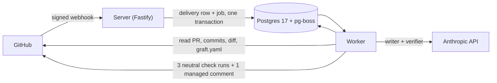
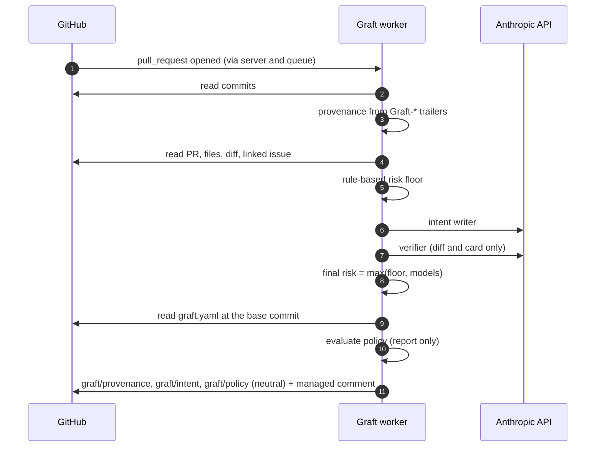

<div align="center">

# Graft

**Intent review and policy checks for pull requests written by coding agents.**

[](https://github.com/mmornati/graft/actions/workflows/ci.yml)


[Quickstart](#quickstart-offline-under-5-minutes) · [Features](#features) · [How it works](#how-it-works) · [Docs](docs/README.md) · [Status](#status-and-roadmap)

</div>

## Why Graft

Coding agents open pull requests faster than people can review them, and a PR description written by the agent being reviewed is not evidence of anything. Graft is a GitHub App and service that puts four answers on every pull request, in one comment and three check runs:

1. **Who wrote it**: an agent (which one, which model, which task, which session) or a human.
2. **What it claims to do**: an *intent card* with the goal, the observable behavior changes and the edits the goal does not explain.
3. **Whether the diff matches**: a second model call checks every claim against the diff alone, and fixed rules set a risk floor that no model can lower.
4. **What the policy says**: the repository's `graft.yaml` decides whether the change would be auto-approved, need humans or a team, or be blocked.

> [!NOTE]
> Graft is in **Phase 0 (shadow mode)**. It reports and never enforces: every Graft check concludes `neutral`, a "would approve" is not an approval, and team membership is not checked. Keep your branch protection as it is.

## Features

| | |
| --- | --- |
| **Provenance**<br/>`Graft-Agent`, `Graft-Model`, `Graft-Task` and `Graft-Session` git trailers (or the PR description), bot accounts, configured logins and agent co-authors decide "agent or human". [More](docs/features/provenance.md) | **Intent cards**<br/>A writer model drafts the card from the title, description, linked issue and diff; a verifier sees only the diff, the file list and the card. Untrusted PR text is fenced as data. [More](docs/features/intent-cards.md) |
| **Risk floor**<br/>`trivial`, `logic` or `sensitive` from fixed rules over paths, size, deleted tests, CI, dependency, infra, auth and migration files. The model can only raise the class. [More](docs/features/intent-cards.md) | **Policy engine, report-only**<br/>`graft.yaml` from the base branch only: block wins, then require, then approve. A `graft/policy` check and a policy section; a CLI and a CI lint. [More](docs/features/policy.md) |
| **Evaluation set**<br/>`pnpm eval`: encrypted pilot case sets outside the repo, blind labeling, Cohen's kappa, fake and live runs, and a synthetic set with a saved baseline in CI. [More](docs/features/evaluation.md) | **Pilots and the gate**<br/>Onboarding kit, verified-reviewer votes, a Wilson-interval Phase 0 gate report, review-time baseline, daily rollup, incidents and offboarding. [More](docs/features/pilots-and-gate.md) |
| **Privacy by design**<br/>No file contents, diffs, PR titles or bodies are stored or logged: only paths, SHAs, numbers and the model's own prose. [More](docs/architecture.md#contracts) | **Live e2e scenarios**<br/>`pnpm graft e2e` proves the fakes' assumptions against real GitHub in a guarded sandbox repository, or fully offline. [More](docs/e2e.md) |

## How it works



The server only verifies, deduplicates and enqueues. The worker runs one job per concern (provenance, intent, policy, pilot), re-reads everything from the GitHub API instead of trusting the webhook payload, and publishes under a per-change lock. Details: [docs/architecture.md](docs/architecture.md).



## Quickstart (offline, under 5 minutes)

You need Node 24 (`.nvmrc`), pnpm 11 and Docker (OrbStack works). Only `pnpm install` and the Docker image pull touch the network; no GitHub App or API key is needed.

```sh
pnpm install
pnpm db:up                         # Postgres 17, published on 127.0.0.1:55432 only
cp .env.example .env
openssl genrsa -out dev.pem 2048   # throwaway key: .env.example points GITHUB_APP_PRIVATE_KEY_PATH at ./dev.pem
pnpm db:migrate
pnpm dev:server                    # terminal 1
pnpm dev:worker                    # terminal 2
pnpm webhook:send installation.created --delivery smoke-1   # 202 {"status":"enqueued"}
pnpm webhook:send installation.created --delivery smoke-1   # 200 {"status":"duplicate"}
curl localhost:3000/readyz         # {"status":"ready","db":"ok","queue":"ok"}
```

Then run the tests (`pnpm test:unit` needs nothing running; `pnpm test` also needs the database) and try `pnpm eval:ci` or `pnpm graft policy check docs/examples/graft.yaml`. Step-by-step notes, expected output and every script: [docs/getting-started.md](docs/getting-started.md). To connect a real App: [docs/github-app.md](docs/github-app.md).

## What a reviewer sees

A fictional pull request in a fictional `acme` organisation: an agent adds a login rate limiter, the shipped [example policy](docs/examples/graft.yaml) applies, one reviewer has approved. This is the managed comment as the renderers in `src/modules/*/render.ts` and `src/github/managed-comment.ts` produce it (the hidden section markers are left out):

> **Graft**
>
> #### Intent
>
> **Goal:** Limit failed login attempts to 5 per account per 15 minutes and lock the account for 15 minutes after that.
>
> **Risk:** `sensitive` · rules `sensitive` · writer `logic` · verifier `logic`
>
> **Behavior changes**
>
> - The sixth failed login for an account within 15 minutes returns 429 with a Retry-After header.
> - A successful login resets the failure counter for that account.
>
> **Out-of-scope edits:** none
>
> <details><summary>How this card was made</summary>
>
> - Rules set the floor to `sensitive`: authentication, security or secrets (`src/auth/rate-limit.ts`, `src/auth/login.ts`)
> - Writer `claude-sonnet-5-5`; verifier `claude-sonnet-5-5` supported 3 of 3 claims
> - Inputs: PR title and description, issue #128, 3 of 3 files in full
> - Model usage: 7,421 input tokens, 913 output tokens, 2 calls
>
> </details>
>
> Card `0b6f3a52` · head `4c9e1f2` · Rate this card with 👍 or 👎 on this comment, or with the buttons on the `graft/intent` check.
>
> #### Provenance
>
> | | |
> | --- | --- |
> | **Authored by** | Agent (Graft trailers) |
> | **Agent** | `claude-code` |
> | **Model** | `claude-sonnet-5-5` |
> | **Task** | `#128` |
> | **Session** | [agents.example.com](https://agents.example.com/session/7f3a) |
> | **Opened by** | `acme-agent[bot]` |
>
> Head `4c9e1f2` · 2 commits, 2 with Graft trailers.
>
> #### Policy
>
> **Would require 2 humans (1 from `@acme/security`)** · report only
>
> - Rule 3 infra-and-auth: paths match `src/auth/login.ts`, `src/auth/rate-limit.ts`, `test/auth/rate-limit.test.ts`
> - Rule 4 agent-sensitive: risk `sensitive` (card), author agent `claude-code`
>
> **Approvals so far:** 1 on this head (`dana`). Team membership is not checked in Phase 0.
>
> Policy `graft.yaml` on `main` at `9d8c7b6` · head `4c9e1f2` · Graft only reports in Phase 0; it approves and blocks nothing.
>
> <sub>Maintained by Graft; edits to this comment are overwritten.</sub>

The same information appears in the `graft/provenance`, `graft/intent` (with "Card is accurate" / "Card is wrong" buttons) and `graft/policy` check runs. When the verifier disagrees, the card shows a warning listing the unsupported claims and the risk is at least `logic`.

## Documentation

| Topic | Read |
| --- | --- |
| Install, run, test | [Getting started](docs/getting-started.md) · [Configuration](docs/configuration.md) · [Troubleshooting](docs/troubleshooting.md) |
| Real GitHub App | [Registration, smee, permissions](docs/github-app.md) |
| Features | [Provenance](docs/features/provenance.md) · [Intent cards](docs/features/intent-cards.md) · [Policy](docs/features/policy.md) ([graft.yaml reference](docs/graft-yaml.md)) · [Evaluation](docs/features/evaluation.md) · [Pilots and gate](docs/features/pilots-and-gate.md) |
| Live tests | [E2E scenarios](docs/e2e.md) · [Runbook](docs/e2e/runbook.md) |
| Internals | [Architecture and data model](docs/architecture.md) · [Decisions and deviations by step](docs/decisions.md) |
| Pilots | [Onboarding runbook](docs/pilots/onboarding.md) · [Starter policies](docs/pilots/) |
| Product | [MVP spec](docs/spec/mvp-spec.md) · [Development plan](docs/plan/development-plan.md) · [Phase 0 steps](docs/phase-0/README.md) · [Human to-do](docs/phase-0/HUMAN-TODO.md) |

The full index is [docs/README.md](docs/README.md).

## Status and roadmap

Graft follows the [development plan](docs/plan/development-plan.md): **Phase 0, shadow mode** (weeks 1 to 6) puts intent cards and provenance on every pilot PR with a report-only policy check, gated on card accuracy of 90% or more; **Phase 1, enforce** (weeks 7 to 12) makes the policy count. Each Phase 0 step is specified, built and reviewed until approved ([how](docs/phase-0/README.md)).

| Step | What it adds | State |
| --- | --- | --- |
| 1 Base setup | Webhook intake with signature check and delivery dedup, job queue, installation tracking, CI. | Built |
| 2 Provenance | Who wrote each PR, in a check run and the managed PR comment. | Built |
| 3 Intent service | A model-written intent card per PR, checked by a second model call and a rule-based risk floor; 👍/👎 and button feedback. | Built |
| 4 Evaluation set | `pnpm eval`: case format, encrypted private storage, export, labeling, harness, metrics, a synthetic CI set. | Built |
| 5 Policy engine | `graft.yaml` read from the base branch, a `graft/policy` check that always concludes `neutral`, a `policy` section, `pnpm graft policy check`. | Built, report-only |
| 6 Pilots and gate | Onboarding kit, review-time baseline, reviewer eligibility for card votes, the gate report with a Wilson interval, daily rollup, incidents, `pnpm graft pilot\|baseline\|gate\|metrics\|incident`, offboarding with `pilot purge`. | Built; gate awaits pilot data |
| Live e2e runner | `pnpm graft e2e`: 10 scenarios and 2 optional baseline scenarios against a real sandbox. | Built |

Still open in Phase 0: the steps only a person can do, such as registering the production App, confirming GitHub behavior that only fakes have tested, recruiting the two pilot teams and collecting the votes for the gate ([HUMAN-TODO](docs/phase-0/HUMAN-TODO.md)).

Phase 1 (planned; none of it is implemented yet): `graft/policy` becomes required, with approvals from reviews and team membership, re-runs on push and review, stale approvals and a break-glass label with an audit log (weeks 7 to 8); a post-merge guard that finds the culprit from existing CI results and opens a revert PR (weeks 9 to 10); a minimal MCP server (`open_change`, `report_provenance`, `get_status`, `get_policy`) with per-repository tokens (week 11); a security review, 5 pilots and a gate (week 12).

## Repository layout

```text
src/
  app/        module registry and cron wiring
  bin/        entry points: server, worker, migrate, eval, graft (CLI)
  config/     environment parsing and validation
  core/       clock, logger, context, glob matcher, signals
  db/         Kysely client, schema, migrations, per-change lock
  queue/      pg-boss wrapper and worker
  webhooks/   receiver, handler registry, dispatch job
  http/       health and readiness routes
  github/     Octokit factory, managed comment, markdown safety
  llm/        model-client interface, Anthropic client, fake
  policy/     graft.yaml schema, safe YAML parse, evaluator, loader
  modules/    installations, changes, provenance, intent, policy, pilot
  eval/       the evaluation tool
  pilot/      CLI-side pilot libraries: baseline, gate, doctor, purge
  e2e/        the live end-to-end runner
eval/         JSON Schemas, synthetic set, saved baseline, thresholds
e2e/          sandbox list and fixtures for the live runner
github/       App manifest and registration page
schema/       graft.yaml JSON Schema (generated)
scripts/      fixture generator, webhook sender, pilot commit hook
test/         unit and integration tests, fixtures, fakes
docs/         documentation
```

The import rules between these folders are in [docs/architecture.md](docs/architecture.md#source-layout).

## Development

```sh
pnpm lint && pnpm typecheck   # Biome, tsc
pnpm test                     # unit + integration (needs pnpm db:up)
pnpm eval:ci                  # synthetic evaluation set against its baseline
pnpm graft policy schema --check
```

CI runs these on every push and pull request, plus `pnpm graft policy check` on the example and starter policies and `pnpm build`. No default test reaches GitHub or the Anthropic API, and none asserts wall-clock time (`pnpm test:perf` opts in).

## Security

Please report vulnerabilities privately, as described in [SECURITY.md](SECURITY.md). Never commit real credentials: `.env` and key files are git-ignored, and the App key, webhook secret, `ANTHROPIC_API_KEY` and `GRAFT_EVAL_KEY` belong in a secret store.

## License

No license has been chosen yet; all rights reserved.
