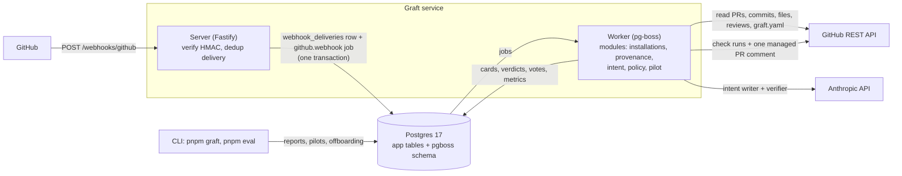
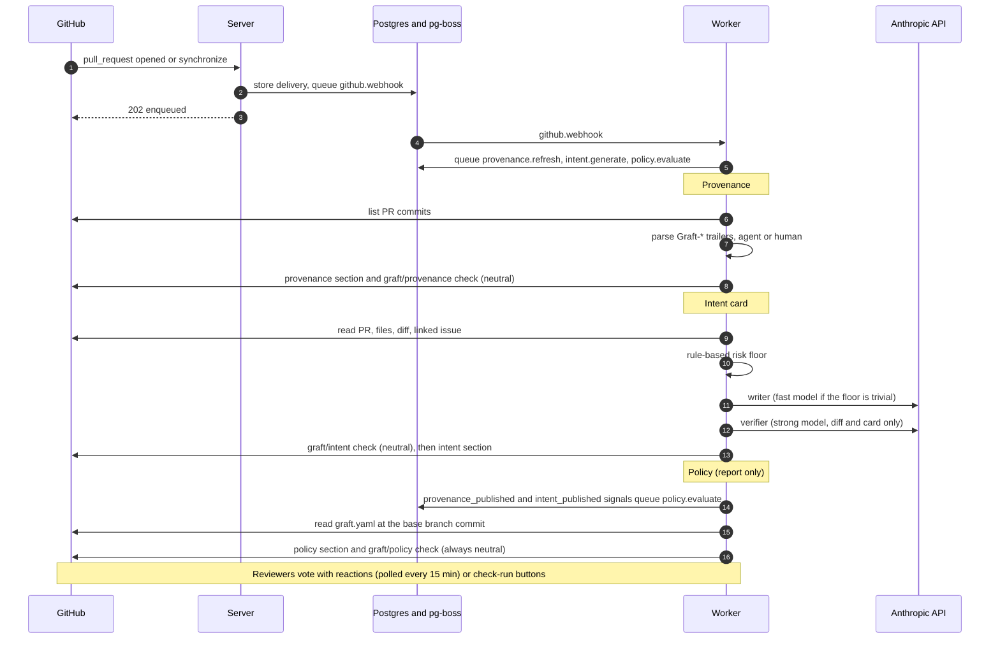
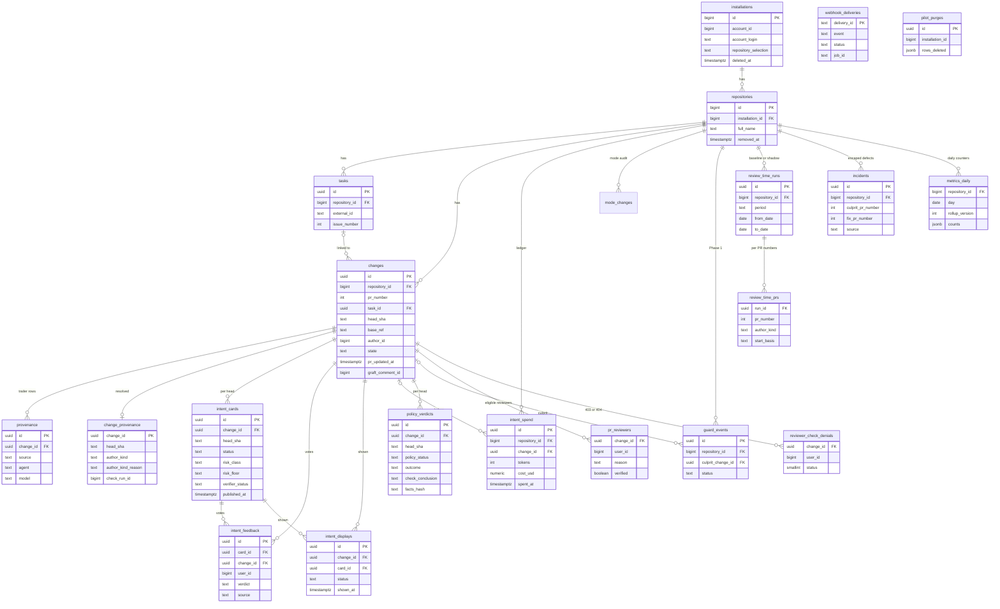

# Architecture

[Docs index](README.md) · [Decisions](decisions.md) · [Configuration](configuration.md)

Graft is one TypeScript codebase with two long-running processes, a **server** and a **worker**, that share one Postgres database. The server only receives webhooks; all GitHub API calls, model calls and publishing happen in jobs that the worker runs through pg-boss. Operator tools (`pnpm graft`, `pnpm eval`) are separate entry points in `src/bin/`.

## Overview

The server verifies the HMAC, inserts the delivery into `webhook_deliveries` with `ON CONFLICT DO NOTHING` and sends the `github.webhook` job in the same transaction. The worker's `github.webhook` job dispatches the event to the handlers that modules register; handlers only validate and enqueue follow-up jobs.

## Lifecycle of a pull request

Each publish happens under a per-change advisory lock (`withChangeLock`) after a freshness re-check, so concurrent or out-of-order jobs never publish stale output. The final risk class is the maximum of the floor and every model's class: the model can raise the class, never lower it.

## Modules and how later steps plug in

**How later steps plug in.** Each feature is a folder `src/modules/<name>/` whose `index.ts` exports `webhookHandlers: WebhookHandler[]` and `jobs: JobDefinition[]`. `src/app/registry.ts` is the only file that lists modules. Step 2 added `modules/changes` (the `changes` row and its guarded upsert; store only, no handlers) and `modules/provenance` (trailers, handlers, the `provenance.refresh` job). Step 3 added `modules/intent` (handlers, the `intent.generate` job, card generation, rendering, feedback) and `src/llm/` (the model-client interface, the Anthropic client, the fake). Step 4 added `eval/` with `src/bin/eval.ts`, and step 5 added `modules/policy`, the `src/policy/` library and `src/bin/graft.ts`. Step 6 added `modules/pilot` (reviewer eligibility sync, label-based incident detection, the daily rollup), `src/pilot/` (the CLI-side libraries: baseline, review-time arithmetic, gate, doctor, purge), `src/bin/graft-ops.ts` and `scripts/pilot/`. Expected addition: `src/mcp/` (Phase 1). A module may also export `signalListeners` (see "Policy contract"). Modules import from `config`, `core`, `db`, `github`, `queue` and `webhooks`. They import another module only through its `index.ts`, never its internals.

## Contracts

- Webhook handlers must be idempotent, because a failed job retries every handler for that delivery. They must also be fast: DB writes, or enqueueing a follow-up job with `ctx.queue.send(...)`. Slow work such as LLM calls or many GitHub API calls goes into its own `JobDefinition`.
- Deliveries can be processed out of order and concurrently (`WORKER_CONCURRENCY`, retries with backoff, and GitHub itself does not order them), so handlers must tolerate reordering. For order-sensitive state, compare the head SHA or the payload's timestamp and ignore stale events, or use a `key_strict_fifo` queue keyed by installation or PR. Step 1's installation handlers are idempotent but not order-proof (for example a late `added` after `deleted`).
- Code that would persist file contents, diffs or patches does not pass review. Only paths, SHAs, numbers and model prose go in the DB.

## LLM contract (step 3)

- Modules never build model clients; they use `ctx.llm` (`LlmClient`, `src/llm/types.ts`). `complete()` **returns** a result for every API outcome (timeout, rate limit, refusal, bad JSON, no API key, ...) and throws only on programmer errors, so failure paths are easy to fake and test.
- No prompt, diff, PR title or body, issue text or raw model output is ever logged, put in job data, or stored as such. Logs carry metadata only (model, purpose, token counts, duration, outcome). The DB holds paths, SHAs, numbers and the model's own prose (goal, behavior changes, reasons), nothing else. `test/unit/log-hygiene.test.ts` and I-INT-5 enforce this.
- Token usage is logged per call and stored per card (`intent_cards.input_tokens`, `output_tokens`, `cache_read_tokens`, `cache_write_tokens`, `llm_calls`, which describe the last run that produced the row); the daily per-repository budget is computed from the append-only `intent_spend` ledger (one row per model run), not from the card rows.
- The system prompt is sent with `cache_control: ephemeral` and is stable per `PROMPT_VERSION`; the volatile diff comes after it.
- All tests use the fake LLM (`src/llm/fake.ts`) or the real client with an injected `fetch`. No test reaches the Anthropic API.
- Model text reaches markdown only through `escapeProse` and `codeSpan` (`src/github/markdown.ts`).

Reviewer feedback on cards (reactions and check-run buttons, and the one exception to the payload rule) is described in [features/intent-cards.md](features/intent-cards.md#feedback-internals).

## Managed PR comment

**Managed PR comment.** Graft keeps exactly one comment per PR, created once and then updated in place (it is not pinned through the API). The contract lives in the doc comment of [`src/github/managed-comment.ts`](../src/github/managed-comment.ts), which steps 3 and 5 reuse:

- The body starts with `<!-- graft:managed-comment v1 -->`, then `## Graft`, then one block per section, `<!-- graft:section:<name>:start -->` ... `<!-- graft:section:<name>:end -->`, in the order `intent`, `provenance`, `policy`; unknown sections found in an existing body are kept verbatim after them. A `` footer closes it.
- Each module writes only its own section through `upsertManagedSection`; every other section is preserved byte for byte. Section markdown may not contain `<!-- graft:` and is capped at 20,000 characters.
- Finding the comment: the stored `changes.graft_comment_id` if it still exists and is ours, else the first of the PR's comments that is ours, else a new comment. **Ours** means the marker is the first line **and** `performed_via_github_app.id` equals `GITHUB_APP_ID`. Because D13 (that field being present on REST comment responses) is unverified against real GitHub, there is a fallback: when `GITHUB_APP_SLUG` is set, a comment authored by the bot login `<slug>[bot]` (type `Bot`) with the marker also counts. A human pasting the marker is never adopted.
- **`withChangeLock(db, changeId, fn)`** (`src/db/locks.ts`): every writer of the managed comment or of per-change GitHub output (check runs) must hold this per-change advisory lock, and must store the comment id in `changes.graft_comment_id` inside the same transaction. The lock is a transaction that holds a pooled connection while requests are in flight, so **do no slow work (LLM calls, diff fetches) inside `withChangeLock`; compute first, then lock, re-check freshness (head SHA and `pr_updated_at`) and publish.**
- **`PermanentJobError(message, reason)`** (`src/queue/errors.ts`): a job throws it when a retry cannot help (deleted PR, lost permission, repo mismatch). The worker logs it and completes the job. `toJobError` in `src/github/errors.ts` maps Octokit errors: 404/410/401/non-rate-limit 403/422 are permanent; 429, rate-limit 403 and 5xx/network errors are retried. It never returns the original error: Octokit errors carry the request body (a rendered card is model output) and pino and pg-boss serialize it, so `sanitizeError` (`src/queue/errors.ts`) rebuilds them as metadata only (name, short message, status, method, route template, request id). The worker sanitizes again before logging and rethrowing, so a job's `pgboss.job.output` and the logs never hold request or response bodies (I-E2E-4).

## Retention of webhook payloads (step 6)

**Retention of webhook payloads (step 6).** `github.webhook` jobs carry the entire webhook payload, which includes PR titles and bodies, so the `github.webhook` queue alone has `deleteAfterSeconds = 3600` (`WEBHOOK_JOB_RETENTION_SECONDS`, set through `JobDefinition.options.deleteAfterSeconds`): a completed or failed job is deleted one hour after it finished. Every other queue keeps 7 days. **Delivery dedup does not depend on the job**: the `webhook_deliveries` primary key (`INSERT ... ON CONFLICT DO NOTHING`, rows are never pruned) is the dedup, and the deterministic job id is only a second line of defence for the hour in which the job exists, so a redelivery after the job is gone is still `duplicate` and creates no job (I-Q-6). Nothing reads old `github.webhook` jobs: `webhook_deliveries.job_id` is informational, and no code, test or document looks a webhook job up by id after the fact. Two caveats: a job that has not run yet (for example the worker is down) stays queued with its payload until pg-boss deletes it (`retentionSeconds`, 14 days by default), and `intent.feedback.record` jobs (voter login, button) still keep their data for 7 days.

## Webhook replay

**Webhook replay.** The webhook HMAC covers only the body, so `X-GitHub-Event` and `X-GitHub-Delivery` are unauthenticated: anyone holding one captured signed body can replay it under a new delivery ID (bypassing the `webhook_deliveries` dedup) or under another event name. Mitigations: (1) a payload is only a **trigger**: `pull_request` and `check_run` handlers validate the payload and enqueue a job, nothing else; the job re-fetches the PR from the API and writes only what the API returned (it also checks the PR number and repository id); (2) every handler parses its payload with a zod schema (`parsePayload`, logging issue paths only) and returns on a mismatch, which catches a relabeled event; (3) replays converge: the same body under a fresh delivery ID yields the same dedup key for the downstream jobs (provenance, intent, policy, ...), so none is created within 7 days (their retention), and a later or stale replay only refreshes live state. The `github.webhook` job itself is keyed by the delivery ID and nothing relies on finding it later: its data is the whole payload (PR titles and bodies), so since step 6 pg-boss deletes it **1 hour** after it completes or finally fails (see the retention note above). **The rule for later steps: handlers treat payloads as triggers; jobs write only from API data or from data Graft computed.** Residual risk: an attacker with a captured body can force extra GitHub API calls after the dedup window of the downstream job (7 days), but cannot forge state. A replayed `check_run.rerequested` body is bounded to one re-run per PR per minute: the key is `prov-rerun:{repoId}:{pr}:{floor(now/60000)}` (and `intent-rerun:...` for the intent check), so a flood of fresh delivery IDs enqueues at most one refresh per PR per minute. The work is idempotent and never forges state; only cost is at stake.

## Source layout

Layout: `src/config` (env), `src/core` (clock, logger, context), `src/db` (Kysely, migrations), `src/queue` (pg-boss wrapper, worker), `src/webhooks` (receiver, registry, dispatch job), `src/github` (Octokit factory, the only place an Octokit is built; managed comment; markdown safety), `src/llm` (model clients: the only place an Anthropic client is built), `src/http`, `src/modules`, `src/eval` (the evaluation tool, step 4: a tool, not a module; it imports Graft code only through `modules/intent/index.ts`, `modules/provenance/index.ts`, `modules/changes/index.ts`, `src/llm`, `src/github/client-factory.ts` and `src/github/errors.ts`, never `db`, `queue`, `webhooks`, `http` or `config`), `src/bin` (entry points, including `eval.ts`), and at the repo root `eval/` (JSON Schemas, the synthetic set, the saved baseline and the thresholds). `src/db` imports nothing from `src/modules`. Step 5 adds `src/policy` (the `graft.yaml` library: schema, safe YAML parse, glob checks, the pure evaluator, the GitHub loader and its cache; it imports nothing from `src/modules`), `src/modules/policy` (handlers, jobs, facts, rendering, store), `src/core/glob.ts` (the glob semantics shared by the risk floor, `GRAFT_INTENT_SENSITIVE_PATHS` and `graft.yaml`), `src/core/signals.ts` (cross-module signals) and `src/bin/graft.ts` (the `pnpm graft policy` CLI). Step 6 adds `src/modules/pilot` (handlers, jobs, signal listener, stores), `src/pilot` (CLI-side libraries; it may import `db`, `config`, `github`, `core` and the modules' `index.ts`; `src/pilot` is imported by `src/bin` and, for `normalizeEvent` and `writeFileAtomic`, `src/e2e`) and `src/bin/graft-ops.ts`, which `graft.ts` loads with a dynamic `import()` for `pilot`, `baseline`, `gate`, `incident` and `metrics`, so that `graft policy check` still runs with an empty environment (U-CLI-6). The live e2e runner adds `src/e2e` (a tool like `src/eval`; **import boundary**: it imports only `src/config`, `src/core`, `src/db/client.ts`, `src/db/migrator.ts`, `src/github/{client-factory,errors,rate-limit,managed-comment}.ts`, `src/llm/pricing.ts`, `src/pilot/baseline.ts` (only `normalizeEvent`), `src/pilot/atomic-write.ts`, `src/policy/parse.ts`, `src/eval/terminal.ts` and the modules' `index.ts`, never `src/bin`, `src/queue`, `src/webhooks`, `src/http` or `test/`; only `src/bin/graft.ts` imports it, with a dynamic `import()`; U-LIVE-BOUND-1 enforces both), `e2e/` at the repo root (the sandbox list and the fixtures) and `docs/e2e/`. `src/modes` (Phase 1 step 1: the pure effective-mode rule; it imports no `db`, `github` or `modules`), `src/modules/modes` (stores, jobs and the mutation gate) and `src/github/mutation-guard.ts` (the write allow-list).

## Policy contract (step 5)

**Policy contract (step 5).** The policy is read from the **base branch only**: `heads/<base ref>` is resolved to a commit when the job runs and `graft.yaml` is read at that SHA, never from the PR head or a pull ref (a PR must not loosen the policy that judges it); a PR that edits the policy file is flagged and can never be would-approved. `src/policy` imports no module, so the intent hook, the policy module and the CLI share one parser; the module graph stays one-way through **signals**: the intent job emits `intent_published` and the provenance job emits `provenance_published` after a publish (outside the lock), and since step 6 the intent module emits `feedback_recorded` after it writes votes (the button job after `recorded`, the reaction poll when it wrote at least one row; the pilot module listens and syncs the change's reviewers at most once per hour, the policy listener returns at once), `JobContext.signals` calls the listeners that modules export as `signalListeners`, and the policy module listens and enqueues `policy.evaluate`. Payloads are triggers: handlers validate and enqueue, jobs re-read everything from the API. The `graft/policy` check run **always concludes `neutral`** in Phase 0, so it is not an approval. Nothing from the file is stored but the hash of the parsed policy: rows hold rule indices, reason codes, PR paths, counts, SHAs and logins. Team names are always rendered as code spans, so the comment never notifies a team.

## Modes contract (Phase 1 step 1)

**Who can set a mode.** Only the operator: the server ceiling `GRAFT_MODE_CEILING` (the worker's environment) and `pnpm graft mode set` (the database, with an audit row in `mode_changes`). Nothing in a repository (`graft.yaml`, labels, PR text) can change a mode, and a `mode` key in `graft.yaml` stays `unknown_key`.

**The effective rule.** `effectiveModes()` in [`src/modes/index.ts`](../src/modes/index.ts) is pure: effective = min(ceiling, requested), then lowered to report/off when a permission the mode needs is missing or was never read, the installation is inactive or the repository was removed (`report < enforce`, `off < on`; a `report` ceiling also forces `mcp_write` off). The needs are `guard_mode: contents write` and `mcp_write: pull_requests write`; `policy_mode` needs nothing beyond Phase 0 in step 1. Installation permissions are read from `GET /app/installations/{id}`, never from a webhook payload. Every feature reads the result through `getEffectiveModes(db, repositoryId, config)`; the policy job reads it once, outside the change lock, and never near the check's `conclusion`, which stays the literal `neutral`.

**The mutation guard.** [`src/github/mutation-guard.ts`](../src/github/mutation-guard.ts) installs a `hook.before("request")` on every client the factory returns (`asApp()` included). GET and HEAD pass; the route table in that file lists the allowed writes, classified `auth`, `phase0` or `phase1` (with the features allowed to use the route). A `phase1` write needs a client made with `forInstallation(id, { feature })` and a gate (`mutationGate` in `src/modules/modes`) that reads the effective mode from the database at request time. Everything not on the table, `/graphql` included, is refused with `MutationRefusedError` (`mutation_refused`, a `PermanentJobError`). A new write is added to the table by the step that needs it, with a case in `test/unit/mutation-guard.test.ts` and, for a Phase 1 feature, a scenario in the neutral regression suite `test/integration/neutral.test.ts`.

**Applying a change (D6, D7).** The ops CLI never enqueues. `mode set` writes `mode_changes` rows with `applied_at = NULL`; the worker cron `modes.apply` claims them with `FOR UPDATE SKIP LOCKED` and sends one repository-scoped `policy.fanout` per repository whose `policy_mode` changed. At start the worker compares `GRAFT_MODE_CEILING` with `service_state('mode_ceiling')` and, when it changed, fans out every active repository.

**D8: the mode is in the facts hash.** The policy job adds the effective `policy_mode` to its `factsHash` and stores it in `policy_verdicts.policy_mode`, so a mode change always republishes the check even when nothing else differs (the "unchanged" short cut compares that hash).

## Data model

Defined in [`src/db/schema.ts`](../src/db/schema.ts) (Kysely types) and created by the migrations in [`src/db/migrations/`](../src/db/migrations/). Every app table cascades from `installations` through `repositories`, which is what makes `pnpm graft pilot purge` complete; `webhook_deliveries` and `pilot_purges` have no foreign key (the purge deletes the installation's deliveries itself, and `pilot_purges` outlives the purge). `guard_events` exists for the Phase 1 post-merge guard and is not written in Phase 0. Only paths, SHAs, numbers, logins or user IDs where needed, and the model's own prose are stored; never file contents, diffs, PR titles or bodies.

`TABLE_NAMES` in `src/db/schema.ts` lists all 20 tables; `OWNED_ROWS` in `src/pilot/purge.ts` must cover each of them (I-PURGE-2).
