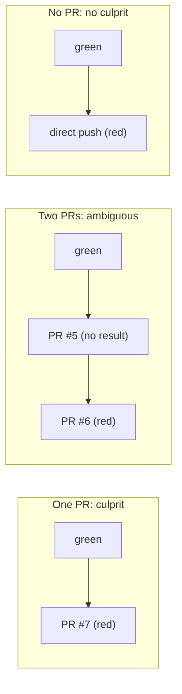

# Post-merge guard

[Docs index](../README.md) · [Modes](modes.md) · [graft.yaml](../graft-yaml.md) · [Configuration](../configuration.md)

The guard watches each repository's default branch. When a CI check that was green turns red, Graft finds the pull request that broke it and says so on that pull request. It never re-runs a check, never bisects, and in this version never opens anything: the revert path is Phase 1 step 5.

Spec: [phase-1/step-4-guard-detection.md](../phase-1/step-4-guard-detection.md). Decisions and deviations: [decisions.md](../decisions.md#phase-1-step-4-guard-detection).

## What the guard watches

- **History.** Every `push` to the default branch starts a `guard.track` job. The job reads the default branch, the commits and the pull request behind each commit from the GitHub API (the push is only a trigger) and stores the first-parent history: SHA, first parent, an increasing sequence number and the PR number. A forced push, an unknown `before`, a root commit or more than 300 new commits mark a **chain break**: Graft never compares across one. Commit messages and files are never stored.
- **CI results.** `check_run.completed`, `check_suite.completed` and `status` events on the default branch (and every push) schedule a `guard.observe` job about 30 seconds later. It reads the commit's check runs from every app (GitHub Actions jobs are check runs) and, with `statuses: read`, its commit statuses, and stores one class per check: `green`, `red` or `ignored`. Only the check name, its source and the class are stored, never output, annotations or logs. Graft's own checks are skipped.

| Check run conclusion | Status state | Class |
| --- | --- | --- |
| `success` | `success` | green |
| `failure`, `timed_out`, `startup_failure` | `failure`, `error` | red |
| `neutral`, `skipped`, `cancelled`, `action_required`, `stale`, not completed | `pending` | ignored |

`cancelled` is ignored because `cancel-in-progress` cancels superseded runs on a busy branch: counting it as red would blame innocent merges.

A check is identified by its source: `run:<app id>:<name>` for a check run (the same name from another app is another check) and `status:<context>` for a status.

## The culprit rule

When a check is red on commit N, Graft looks back along the first-parent chain (no break crossed) for the nearest commit with a green or red result for that check. If it is red, `main` was already red and nothing happens. If it is green, the commits after it, up to N, are the **candidates**:



- Every candidate belongs to the same PR (a squash or merge commit, or the commits of one rebase merge): that PR is the **culprit** (`culprit_found`).
- Two or more PRs, a direct push next to a PR, a commit with several merged PRs, or a commit Graft could not map: **ambiguous**. Graft lists the candidates and comments nowhere.
- Only direct pushes: **no culprit**.

Several checks going red on the same commit are one event. A check that goes red later while an event is open for the same culprit joins that event.

## Confirmation

On by default (`GRAFT_GUARD_CONFIRM=on`). A new event starts as `confirming` and is settled when:

1. the next commit is red on one of the event's checks: confirmed;
2. every failing check is green again, on N (a re-run) or on the next commit: **flaky**, and nothing else happens;
3. the window (`GRAFT_GUARD_CONFIRM_SECONDS`, 2 hours by default) has passed and a failing check is still red on N: confirmed. A `guard.confirm` job runs at the deadline, so a quiet repository is still settled.

With `GRAFT_GUARD_CONFIRM=off` the outcome is final at detection.

## What report mode writes

A confirmed culprit gets **one new comment** on its pull request (which notifies its participants, which is the point):

```md
<!-- graft:guard-event 3f0c…-uuid -->
### Graft guard

CI check `test` went red on `main` at `abc1234` after this pull request was merged. It was green at `9f8e7d6`, the commit before.

- Failing: `test`, `lint (node 24)` ([details](https://github.com/acme/app/runs/123))
- Confirmed by: the next commit `def5678` is also red

Graft would open a pull request reverting this merge. Fix forward or revert to clear it.

Graft mode: report. Graft opens nothing; this is what it would do.
```

That is the guard's only write in this version, through the same comment route Graft already uses for its managed comment. The hidden first line makes retries safe: before writing, Graft looks for its own comment with that marker. Ambiguous, flaky and no-culprit events produce no comment; they are visible in `graft guard list` and the database. With `guard_mode: enforce` effective (see [Modes](modes.md)), only the last line changes: "Revert PRs are not available in this version; nothing was opened."

## Scoping the guard: `guard.checks`

```yaml
version: 1
guard:
  checks: [test, "lint (node 24)", ci/jenkins]
```

When present, only these check names and status contexts (exact, case-sensitive) can open an event. The list is read from `graft.yaml` at the **last green commit before the candidates**, never from the failing commit, so a pull request cannot remove its own failing check from the list. A missing or invalid file there means every check counts. See [graft.yaml](../graft-yaml.md#keys).

## `graft guard list`

```sh
pnpm graft guard list --repo owner/name [--status culprit_found] [--limit 20] [--json]
```

One line per event, newest first:

```text
2026-10-14T12:01:00Z  culprit_found  abc1234  test, lint (node 24)  culprit #7
2026-10-13T09:12:00Z  ambiguous      9f8e7d6  test  candidates #5 #6
2026-10-12T16:40:00Z  no_culprit     1234abc  test  no PR
```

`--json` prints `{ events: [{ id, status, failingSha, lastGreenSha, failingChecks, culpritPr, candidatePrs, unresolvedCommits, detectedAt, confirmedAt, commentId, guardMode }] }`. `graft mode show` notes when an installation has no `statuses: read` (the guard reads check runs only) and when `GRAFT_GUARD_DETECTION=off` in the shell's configuration. `graft pilot doctor` warns about both that and events stuck in `confirming` past twice the window.

## Switches and retention

- `GRAFT_GUARD_DETECTION=off` stops the guard: the handlers drop every event and the jobs and crons do nothing.
- `main_commits` and `ci_results` rows older than `GRAFT_GUARD_RETENTION_DAYS` (30) are deleted by the daily `guard.prune` cron, except the commits an open event still refers to. `pnpm graft pilot purge` deletes both tables with the installation.

## What step 5 adds

In enforce mode, with `contents: write`, step 5 opens the revert pull request for a confirmed culprit (built from blob SHAs, without reading code), labels it, and optionally enables auto-merge on it (`guard.auto_merge_reverts`). Until then nothing in the guard uses a Phase 1 write route.
