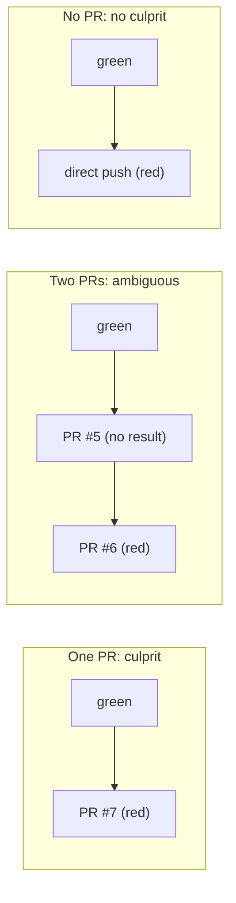

# Post-merge guard

[Docs index](../README.md) · [Modes](modes.md) · [graft.yaml](../graft-yaml.md) · [Configuration](../configuration.md)

The guard watches each repository's default branch. When a CI check that was green turns red, Graft finds the pull request that broke it and says so on that pull request. In report mode (the default) it also says how it would revert it; with `guard_mode: enforce` it opens that revert as a pull request (Phase 1 step 5). It never re-runs a check, never bisects, never pushes to the default branch and never merges anything itself.

Specs: [phase-1/step-4-guard-detection.md](../phase-1/step-4-guard-detection.md) (detection), [phase-1/step-5-revert-prs.md](../phase-1/step-5-revert-prs.md) (revert pull requests). Decisions and deviations: [step 4](../decisions.md#phase-1-step-4-guard-detection), [step 5](../decisions.md#phase-1-step-5-revert-prs).

## What the guard watches

- **History.** Every `push` to the default branch starts a `guard.track` job. The job reads the default branch, the commits and the pull request behind each commit from the GitHub API (the push is only a trigger) and stores the first-parent history: SHA, first parent, an increasing sequence number and the PR number. A forced push, an unknown `before`, a root commit or more than 300 new commits mark a **chain break**: Graft never compares across one. Commit messages and files are never stored.
- **CI results.** `check_run.completed`, `check_suite.completed` and `status` events on the default branch (and every push) schedule a `guard.observe` job about 30 seconds later. It reads the commit's check runs from every app (GitHub Actions jobs are check runs) and, with `statuses: read`, its commit statuses, and stores one class per check: `green`, `red` or `ignored`. Only the check name, its source and the class are stored, never output, annotations or logs. Graft's own checks are skipped.

| Check run conclusion | Status state | Class |
| --- | --- | --- |
| `success` | `success` | green |
| `failure`, `timed_out`, `startup_failure` | `failure`, `error` | red |
| `neutral`, `skipped`, `cancelled`, `action_required`, `stale`, not completed | `pending` | ignored |

`cancelled` is ignored because `cancel-in-progress` cancels superseded runs on a busy branch: counting it as red would blame innocent merges.

A check is identified by its source: `run:<app id>:<name>` for a check run (the same name from another app is another check) and `status:<context>` for a status. When one check has several runs, the latest completed run wins inside one check suite (a re-run). Across check suites (two workflows with a job of the same name) a red run wins, so a later green run elsewhere cannot hide a failure.

The `status` event's branch list only names up to 10 branches that contain the commit, so a full list without the default branch still schedules an observe; the job keeps only commits on the default branch.

## The culprit rule

When a check is red on commit N, Graft looks back along the first-parent chain (no break crossed) for the nearest commit with a green or red result for that check. If it is red, `main` was already red and nothing happens. If it is green, the commits after it, up to N, are the **candidates**:



- Every candidate belongs to the same PR (a squash or merge commit, or the commits of one rebase merge): that PR is the **culprit** (`culprit_found`).
- Two or more PRs, a direct push next to a PR, a commit with several merged PRs, or a commit Graft could not map: **ambiguous**. Graft lists the candidates and comments nowhere.
- Only direct pushes: **no culprit**.

Several checks going red on the same commit are one event. A check that goes red later while an event is open for the same culprit joins that event.

Results arrive in any order. If a candidate's CI finishes later than the failing commit's and turns out green, the open event narrows to the commits after it (so two candidates can become one culprit). If it turns out red, the event moves to that earlier commit.

## Confirmation

On by default (`GRAFT_GUARD_CONFIRM=on`). A new event starts as `confirming` and is settled when:

1. the next commit is red on one of the event's checks: confirmed;
2. every failing check is green again, on N (a re-run) or on the next commit: **flaky**, and nothing else happens;
3. the window (`GRAFT_GUARD_CONFIRM_SECONDS`, 2 hours by default) has passed and a failing check is still red on N: confirmed. A `guard.confirm` job runs a minute after the deadline, so a quiet repository is still settled.

An event still undecided then (for example its re-run ended `cancelled`, so the check is neither red nor green) is examined twice more, a window apart. If it is still undecided at the last attempt, the failure did not persist: the event settles as **flaky** with no reason, and nothing is written.

With `GRAFT_GUARD_CONFIRM=off` the outcome is final at detection.

## The guard comment

A confirmed culprit gets **one new comment** on its pull request (which notifies its participants, which is the point). It is written by the `guard.revert` job, after the revert plan, in every mode:

```md
<!-- graft:guard-event 3f0c…-uuid -->
### Graft guard

CI check `test` went red on `main` at `abc1234` after this pull request was merged. It was green at `9f8e7d6`, the commit before.

- Failing: `test`, `lint (node 24)` ([details](https://github.com/acme/app/runs/123))
- Confirmed by: the next commit `def5678` is also red

Graft would open a pull request reverting this merge (4 paths restored to `9f8e7d6`) and would not enable auto-merge: `guard.auto_merge_reverts` is not set in graft.yaml at the last green commit.

Graft mode: report. Graft opens nothing; this is what it would do.
```

In report mode that comment is the guard's only write, through the same comment route Graft already uses for its managed comment. The hidden first line makes retries safe: before writing, Graft looks for its own comment with that marker. Ambiguous, flaky and no-culprit events produce no comment; they are visible in `graft guard list` and the database. The paragraph before the mode line says what happened to the revert (next section); the mode line says `Graft mode: enforce.` in enforce mode, and `Graft mode: report (enforce requested; permission_missing contents:write). …` when enforce was asked for but is not effective, with the reason. Mentions never appear in this comment (paths and check names are code spans).

## Scoping the guard: `guard.checks`

```yaml
version: 1
guard:
  checks: [test, "lint (node 24)", ci/jenkins]
```

When present, only these check names and status contexts (exact, case-sensitive) can open an event. The list is read from `graft.yaml` at the **last green commit before the candidates**, never from the failing commit, so a pull request cannot remove its own failing check from the list. A missing or invalid file there means every check counts. See [graft.yaml](../graft-yaml.md#keys).

**A narrowed event and two baselines** (step 4 review 2, finding E). When a candidate's CI finishes late and green, an open event narrows to the commits after it, and its last green commit moves forward. Detection judged the failing check against `guard.checks` at the **older** baseline, and the narrowed event keeps that verdict: re-reading the file then would make the outcome depend on whether the parent's CI finished before or after the child was observed. A revert needs more: before opening one, Graft checks the failing checks against `guard.checks` at the event's **current** last green commit too, and drops the ones it does not list. If none is left, the revert is `skipped` / `filtered_at_baseline`. For an event that never narrowed, the two baselines are the same commit. Neither is ever the culprit's own commit.

## The trust boundary

The guard detects breakage; it is **not** a control against a hostile merge. A merged pull request controls the CI that judges it: it can change its own tests or workflows, and a workflow running on `main` with the default token can post check runs or statuses on other commits. Such a change can hide its own failure (a later green on N makes the event `flaky`, a red on the commit before makes `main` "already red"). Reading `guard.checks` from the baseline and letting red win across check suites close the cheapest routes, not every route.

Once a culprit becomes a revert (step 5), the same power could also **frame** a pull request: a workflow on `main` posts a red result on the commit after an innocent merge and a green one on the commit before, and the innocent PR gets a revert PR. What bounds it:

- **A revert is a pull request.** Nothing lands without branch protection, required checks, and (for a sensitive culprit, a break-glass merge, a missing card or a policy file) a human merge. A framed revert is visible, labelled `graft:revert`, mentions the author, and can be closed.
- **Confirmation is required.** One forged red is not enough: it must persist across the next commit or the window. With `GRAFT_GUARD_CONFIRM=off` nothing is reverted.
- **The cap** (`GRAFT_GUARD_MAX_OPEN_REVERTS`, 3) and **one revert per culprit** bound a repeated framing to a few pull requests.
- **The baseline decides scope and auto-merge.** `guard.checks` and `guard.auto_merge_reverts` are read at the last green commit before the culprit, so the culprit can neither widen the checks nor opt its own revert into auto-merge.
- **Auto-merge is opt-in per risk class** and never for `sensitive`, so a team that fears framing leaves `auto_merge_reverts` unset.

**Residual risk.** A framing workflow already merged on the default branch can get a `trivial` or `logic` PR's revert auto-merged where a team opted in, if the revert's own required checks pass. The fix is to revert the revert by hand (Graft never reverts a revert). A workflow that can write results on `main` is already a merged, reviewed change, and the Phase 1 step 7 security review re-reads this section.

Two more limits, inherent to reverts: a later commit that depends on the culprit (it calls a function the culprit added, in a file the culprit did not touch) is not a conflict for Graft, so the revert PR's own CI is what catches it; and if the default branch moves between Graft's read of its tip and the pull request, GitHub's three-way merge decides, a conflict shows on the PR and auto-merge waits.

**Re-runs and `workflow_dispatch`** (step 4 review 2, finding B). Graft reads every run of a commit (`filter=all`) and lets red win across check suites, so a later green from another workflow cannot hide a failure. The trade-off: a fresh `workflow_dispatch` run on the same SHA is another check suite, so its green does not make the event `flaky` (only a re-run inside the failing suite, "Re-run failed jobs", does). A repository with no next commit is confirmed by the window instead. HUMAN-TODO checks both on a sandbox.

## `graft guard list`

```sh
pnpm graft guard list --repo owner/name [--status culprit_found] [--limit 20] [--json]
```

One line per event, newest first:

```text
2026-10-14T12:01:00Z  culprit_found  abc1234  test, lint (node 24)  culprit #7
2026-10-13T09:12:00Z  ambiguous      9f8e7d6  test  candidates #5 #6
2026-10-12T16:40:00Z  no_culprit     1234abc  test  no PR
```

Since step 5 a last column says what the revert became: `would revert 4 paths`, `revert #456 (auto-merge on)`, `needs human: touched later (3)`, `skipped: cap reached`, `error: tree_mismatch`. `--status` also accepts `needs_human`, `revert_opened`, `reverted` and `revert_closed`.

`--json` prints `{ events: [{ id, status, failingSha, lastGreenSha, failingChecks, culpritPr, candidatePrs, unresolvedCommits, detectedAt, confirmedAt, confirmReason, commentId, guardMode, revert: { outcome, reason, prNumber, branch, commitSha, planPaths, conflicts, autoMergeState, autoMergeReason } }] }`. `graft mode show` notes when an installation has no `statuses: read` (the guard reads check runs only), when `GRAFT_GUARD_DETECTION=off` and when `GRAFT_GUARD_REVERT=off` in the shell's configuration. `graft pilot doctor` warns about the first, about events stuck in `confirming` past twice the window, about revert PRs open for more than 72 hours and about revert jobs that ended in `error` in the last 7 days.

## Switches and retention

- `GRAFT_GUARD_DETECTION=off` stops the guard: the handlers drop every event and the jobs and crons do nothing.
- `main_commits` and `ci_results` rows older than `GRAFT_GUARD_RETENTION_DAYS` (30) are deleted by the daily `guard.prune` cron, except the commits an open event still refers to and each repository's newest commit (so a quiet repository's next merge still has a green baseline). `pnpm graft pilot purge` deletes both tables with the installation.

## Revert pull requests

**When.** Only an event that reached `culprit_found` with a real confirmation (the next commit is red, or the window passed). Never `ambiguous`, `no_culprit`, `flaky` (with or without a reason) or `confirming`, and never an event settled with `GRAFT_GUARD_CONFIRM=off` (`skipped` / `confirmation_off`). When the culprit is itself a revert pull request Graft opened, nothing is reverted (`skipped` / `revert_of_revert`): Graft knows its reverts from its own database, never from a branch name, label or trailer, which anyone can copy.

**The plan, in every mode.** The `guard.revert` job computes the revert from git **tree entries** only (path, mode, type and object SHA, through `GET …/git/trees/{sha}` and `GET …/git/commits/{sha}`); no file content, blob, patch or diff is ever fetched. The culprit's commits on the default branch are its squash or merge commit, or the commits of its rebase merge, which must be contiguous; the plan compares the tree before them with the tree after them, descending only into directories whose SHAs differ, and lists the changed paths with their entry before and after. In report mode the plan is the comment's paragraph and costs only GET requests.

**Needs a human.** Graft opens nothing, the event becomes `needs_human` and the comment says why, when:

- a changed path was changed again on the default branch after the merge (its entry at the tip is not the culprit's): `touched_later`, with the paths listed (at most 20). A path changed and changed back is not a conflict;
- the culprit changed `.github/workflows/`: a commit there needs the `workflows` permission, which Graft does not request;
- a submodule changed, or a file became a directory (or the reverse);
- the change is too large (more than `GRAFT_GUARD_REVERT_MAX_PATHS` paths, more than `GRAFT_GUARD_REVERT_MAX_TREE_READS` tree reads, or a truncated tree);
- Graft does not have the merge's full history (its commits are not contiguous, or a forced push came after).

When every changed path is already back to its state before the culprit, nothing is opened (`skipped` / `already_reverted`); when a later commit is green again on the failing checks before the revert opens, neither (`skipped` / `already_green`).

**The revert, in enforce mode.** With `guard_mode: enforce` effective (which needs `contents: write`), Graft writes, through its `guard` feature client: one tree (the tip's tree with each changed path restored to its entry before the culprit, and each path the culprit added removed), checked against the plan before anything is visible; one commit on the tip, with no author (GitHub sets the App's identity); a branch `graft-revert/<event id>`; one pull request against the default branch; and the `graft:revert` label. The pull request:

```md
Revert #123 (Graft guard)

Graft's post-merge guard opened this pull request to revert #123.

CI check `test` went red on `main` at `abc1234` after #123 was merged. It was green at `9f8e7d6`, the commit before, and the failure was confirmed (the next commit `def5678` is also red).

- Failing: `test`, `lint (node 24)` ([details](https://github.com/acme/app/runs/123))
- Reverts: 4 paths, restored to `9f8e7d6`
- Author: @alice · Task: #42 · [agent session](https://…)
- Auto-merge: on (risk `logic`, allowed by `guard.auto_merge_reverts`)

Branch protection and required checks decide whether this merges. Close it to keep #123; fix forward instead.

Graft-Agent: graft-guard
```

It mentions the culprit's author (for a bot author, the user who merged it), links the agent's task and session from provenance (a `#N` task is a live reference, anything else a code span), and uses nothing from the culprit's title, body or commit messages. That is the only place the guard mentions anyone. The guard comment on the culprit then says `Graft opened #456 to revert this merge. Auto-merge: on.` (or `off:` and the reason).

**Auto-merge, opt-in.** With `guard.auto_merge_reverts: [trivial, logic]` in [graft.yaml](../graft-yaml.md#keys) at the last green commit before the culprit, Graft enables **GitHub auto-merge** on the revert pull request (the GraphQL `enablePullRequestAutoMerge` mutation, with the first of squash, merge and rebase the repository allows), so branch protection and required checks still decide; Graft never merges. It stays off, with the reason stored, when: the key is not set there (`not_configured`) or the file is invalid; the culprit has no `ok` intent card at its merged head (`card_missing`); its risk class is not listed (`risk_not_listed`; `sensitive` can never be listed); it was merged under break-glass; the revert changes `graft.yaml`; or the repository does not allow auto-merge. If GitHub refuses (for example the pull request is already mergeable with no required checks), auto-merge is `unavailable` and nothing else happens. Graft never disables auto-merge once enabled.

**The cap.** At most `GRAFT_GUARD_MAX_OPEN_REVERTS` (3) events per repository have an open revert pull request; another confirmed culprit is `skipped` / `cap_reached`. A revert pull request that is merged (`reverted`) or closed (`revert_closed`) releases its slot: the `pull_request.closed` webhook of a `graft-revert/` branch starts a check of the pull request through the API, and a default-branch commit that maps to the revert pull request does the same if the webhook was missed. At most one revert is ever opened per culprit.

**Exactly once.** One `guard.revert` job per event. Each write's result is stored before the next (commit, branch, pull request, label, auto-merge, comment), so a retry resumes; the branch name is a function of the event, and a retry that finds the branch looks up its pull request by head before opening one. A stale branch (the tip moved between a crash and the retry) is deleted and created again: the only deletion Graft makes.

**The kill switch.** `GRAFT_GUARD_REVERT=off` stops reverts: the comment is step 4's (no plan) and the event records `skipped` / `revert_off`. Detection is unaffected. `GRAFT_GUARD_DETECTION=off` still stops everything.

**Rolling back.** `pnpm graft mode set --guard report` takes effect at Graft's next write: the mutation guard reads the mode at every request, so a job that was opening a revert stops at its next write (`error` / `mode_changed`) and keeps whatever it already created. An open revert pull request, and its auto-merge, stay as they are: close the pull request, or disable auto-merge on it, by hand.
