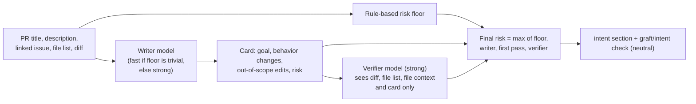

# Intent cards

[Docs index](../README.md) · [Provenance](provenance.md) · [Policy](policy.md) · [Evaluation](evaluation.md)

An intent card says, in a few lines, what a pull request actually does, checked against the diff by a second model call and backed by a rule-based risk class that a model can raise but never lower.

For every open PR, Graft writes an **intent card** into the `intent` section of the managed comment and into a `graft/intent` check run (always `neutral` in Phase 0). Reviewers read the card instead of the PR description. It holds:

- **Goal**: one sentence stating what the diff does.
- **Behavior changes**: observable effects, most important first.
- **Out-of-scope edits**: files the goal does not explain (from the writer, plus any the verifier flags).
- **Risk**: `trivial`, `logic` or `sensitive`, shown with where it came from (`rules`, `writer`, `verifier`).

**How it is made.** A writer model reads the PR title and description, the linked issue (`Fixes #N`, the `Graft-Task` issue, or the first `#N`), the file list and the diff. A second call, the verifier, sees the diff, the file list, the changed files as they are at the head (the file context, below) and the card, but **not** the title, description or issue, and checks every claim. The PR description comes from the agent being judged, so it is untrusted input: it is wrapped in nonce-tagged data blocks, the prompts say it is data, and injection markers raise the floor.

**Risk classes and the floor.** The final class is `max(floor, writer, first pass, verifier, logic if the verifier disagrees or fails, logic if injection is suspected)`. **The model can only raise the class, never lower it.** The floor comes from fixed rules over each file's path (and previous path, so renames count both ways), case-insensitively:

| Floor | Rule |
| --- | --- |
| `sensitive` | CI and repository config (`.github/workflows/**`, `CODEOWNERS`, ...); `graft.yaml`; dependency manifests and lockfiles; infrastructure and deployment files; auth, security, crypto and secrets paths; migrations and schema files; paths in `GRAFT_INTENT_SENSITIVE_PATHS`; a deleted test; more than 1,500 changed lines or 50 files; a PR too large to list; an incomplete file list |
| `logic` | a test that lost 10 or more lines; an added binary; more than 300 lines or 15 files; part of the diff not shown to the model (truncated, generated, no patch); text addressed to AI reviewers |
| `trivial` | nothing above matched |

Without a checked card (no API key, model down, budget used up) the risk is at least `logic`, and the card says why.

**File context (since `intent-v2`).** A patch shows only the changed lines and three lines around them, so a claim such as "scrolling stops during a replay" could not be checked when the line that sets the replay flag was further away. Graft therefore reads up to 20 modified, renamed or copied source files at the head commit (not added files, whose patch is the whole file, nor lockfiles, binaries, generated files or files a `sensitive` path rule matches, such as secrets, CI or infrastructure files; at most 200 KB each) and gives the verifier, never the writer, either the whole file with line numbers (up to 16,000 characters) or excerpts: 20 lines around each hunk plus 2 lines around other uses of the names the changed lines use (a name used more than 12 times is too common to help). The context of all files is capped at 60,000 characters. The verifier is told the context is unchanged code, for reference only: it never counts as a behavior change.

**Verdicts.** Each claim is `supported`, `unsupported` (the diff does not show it), `contradicted` (the diff shows something else), or `unverifiable`: the changed lines do what the claim says, but whether it holds depends on unchanged code the verifier was not shown, such as a function in an untouched file. An unverifiable claim is listed in a note under the card and does not count as a disagreement. The hidden part of a truncated or omitted file is part of the change, so a claim that depends on it stays `unsupported`.

**"The verifier disagrees"** means that at least one claim on the card is unsupported or contradicted, or that the verifier found observable behavior changes the card does not mention. The comment then shows a warning listing them, and the risk is at least `logic`. "Not verified" means the verifier call failed.

**Rating a card.** Click 👍 or 👎 on the Graft comment, or press "Card is accurate" / "Card is wrong" on the `graft/intent` check. Reactions are picked up within 15 minutes. One vote counts per user and card, and the latest wins. The data feeds the 90% accuracy gate.

**Sensitive paths.** Add globs (comma-separated, for example `services/billing/**,**/payments/**`) to `GRAFT_INTENT_SENSITIVE_PATHS`; since step 5 the `sensitive_paths` of the base branch's `graft.yaml` extend the list (the pull request's own copy is ignored; a missing or invalid file leaves the environment value alone). A glob without `/` matches at any depth; a leading `/` anchors it at the repository root. Since step 6 the value is validated at startup with the same checks as `graft.yaml` (a failure names the glob's position and the reason, never the value, and the process exits), including the lookalike check described in [docs/graft-yaml.md](../graft-yaml.md); a glob with non-ASCII characters logs one warning.

**Without an API key** (none of `ANTHROPIC_API_KEY`, `ANTHROPIC_AUTH_TOKEN` or the federation variables set) the service runs and every card shows as unavailable with the rule-based floor.

## Feedback internals

**Feedback (step 3).** Reviewers rate each intent card in two ways. (a) 👍/👎 reactions on the managed comment: GitHub sends no webhook for them, so a scheduled sweep (`intent.feedback.sweep`, cron `GRAFT_FEEDBACK_POLL_CRON`, default every 15 minutes, run by the worker only) enqueues `intent.feedback.poll` for open PRs and recently closed ones, which lists the comment's reactions. A reaction is attributed **by time** to the card that was displayed when it was made (the card with the greatest `published_at` not after the reaction), because one comment shows a series of cards. (b) The buttons "Card is accurate" and "Card is wrong" on the `graft/intent` check run (`requested_action` webhook) belong to exactly the card whose id is in the check run's `external_id`. One vote is stored per `(card, user, source)`; the effective vote per `(card, user)` is the latest across sources; bots are ignored; `is_pr_author` is recorded, and `feedbackSummary` leaves PR authors out by default. **Exception to the payload rule:** the `requested_action` handler only enqueues `intent.feedback.record`, and that job confirms the check run through `checks.get` (our app, name `graft/intent`, an `external_id` that is a card of this repository) but takes the voter and the button from the payload. Residual risk: a replayed captured body can re-assert the same vote, but cannot create a vote for another user.

## Related

- The LLM contract (no prompt or diff is ever logged or stored, token accounting, prompt caching): [architecture.md](../architecture.md#llm-contract-step-3).
- Model, budget and polling settings: `ANTHROPIC_API_KEY` (or `ANTHROPIC_AUTH_TOKEN` and `ANTHROPIC_BASE_URL` for a gateway, or Workload Identity Federation), `GRAFT_LLM_*`, `GRAFT_INTENT_SENSITIVE_PATHS`, `GRAFT_FEEDBACK_POLL_CRON` in [configuration.md](../configuration.md).
- Measuring card quality: [evaluation.md](evaluation.md). The 90% accuracy gate: [pilots-and-gate.md](pilots-and-gate.md#the-gate).
- Implementation choices: [decisions.md, step 3](../decisions.md#step-3-intent-service). The step spec: [docs/phase-0/step-3-intent-service.md](../phase-0/step-3-intent-service.md).
