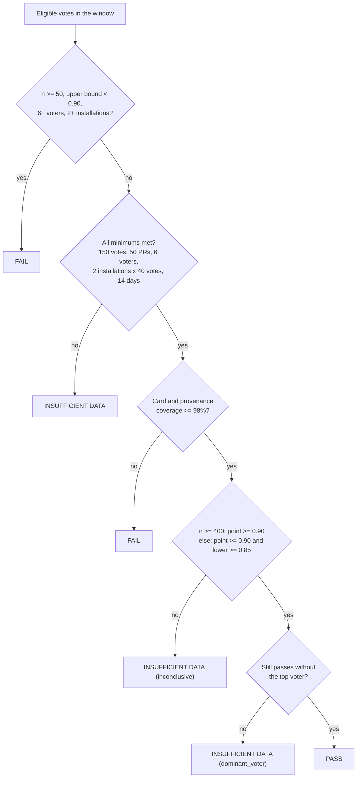

# Pilots and the gates

[Docs index](../README.md) · [Onboarding runbook](../pilots/onboarding.md) · [Intent cards](intent-cards.md)

Phase 0 ends when two pilot teams have used Graft in shadow mode and the data says the intent cards are accurate enough: at least 90% of eligible reviewer votes say "accurate", with enough votes, voters, installations and days behind the number. This page covers the operator CLI for pilots, the gate rule, the review-time baseline, the daily rollup and incidents. The examples use fictional installations (`123`, `456`), a fictional repository (`acme/api`) and fictional dates.

Step 6 makes onboarding the two pilot teams repeatable and decides the Phase 0 gate from data. **Phase 0 still enforces nothing**: no code path of this step changes a check conclusion, a branch protection or a PR. The runbook is [docs/pilots/onboarding.md](../pilots/onboarding.md); the starter policies are `docs/pilots/graft.{service,platform,library}.yaml`; `scripts/pilot/prepare-commit-msg` adds `Graft-*` trailers from `GRAFT_AGENT`, `GRAFT_MODEL`, `GRAFT_TASK` and `GRAFT_SESSION` for any agent harness that can set environment variables.

## Commands

```sh
pnpm graft pilot doctor --installation 123 [--json]            # 10 DB-only checks, OK/WARN/FAIL, exit 1 on any FAIL
pnpm graft pilot sync-reviewers --installation 123 --since 2026-11-01
pnpm graft pilot sweep-feedback --installation 123             # poll the reactions now (the cron does it every 15 minutes)
pnpm graft pilot allow-list resolve allow.txt --installation 123
pnpm graft pilot purge --installation 123 --confirm acme [--dry-run] [--even-if-active]
pnpm graft baseline --repo acme/api --from 2026-08-01 --to 2026-10-31 [--period baseline|shadow] [--base main]
                    [--max-requests 5000] [--max-wait 15m] [--dry-run] [--auth app|token]   # token: dry run only
pnpm graft gate report --installation 123 --installation 456 --since 2026-11-01 [--until 2026-11-29]
                       [--allow-file allow.txt] [--out dir] [--json] [--check]
pnpm graft metrics rollup --installation 123 --from 2026-11-01 --to 2026-11-29
pnpm graft incident add --repo acme/api --pr 812 [--fix-pr 830] [--occurred-at ISO] [--severity 1-4]
pnpm graft incident list --installation 123 [--json]
pnpm graft incident remove --id <uuid>
```

Every command loads `.env` and the configuration (a bad value exits 2 with the variable's name only), opens the database and stops with `run pnpm db:migrate` when the schema is behind. Exit codes: 0 ok, 1 check failed (doctor FAIL, `gate report --check` FAIL), 2 usage or configuration, 3 aborted (rate-limit wait above `--max-wait`, `--max-requests`, a purge refused: wrong `--confirm`, or an active installation without `--even-if-active`), 4 `gate report --check` with INSUFFICIENT DATA. Output passes through `toTerminalSafe`. Dates are `YYYY-MM-DD` at UTC midnight; `--to` and `--until` are exclusive.

| Command | What it does |
| --- | --- |
| `pilot doctor` | Installation, repositories, deliveries, failed jobs, cards, feedback, policy, budget, rollup and cron checks. Reads the database and pg-boss only (`<schema>.job` with `state = 'failed'` and `data->>'installationId'`, and `<schema>.schedule`). |
| `pilot sync-reviewers` | Backfills `pr_reviewers` (who was requested or reviewed, verified against the repository; see the gate below) for changes opened since a date; run once after deploying step 6 and again after migration 0007, which marks every earlier row unverified. |
| `pilot sweep-feedback` | Polls the reactions on the managed comments of one installation's open and recently closed PRs **inline** (the CLI has no queue; `intent.feedback.sweep` enqueues the same polls every 15 minutes) and prints `polled <n> PRs, <m> votes recorded, <k> skipped`. A permanent error skips the PR; the CLI has no signal listeners, so run `pilot sync-reviewers` afterwards. |
| `pilot allow-list resolve <file>` | Looks up the numeric user ID of every login-only line (`alice` or `@alice`; `@1234` for a numeric login) with `users.getByUsername` (public data, through the installation's token) and rewrites it as `login:id`. The write is atomic: a temp file in the same directory, fsynced, renamed over the original (mode kept). All-or-nothing: an unknown login (exit 3, line numbers only) writes nothing. |
| `pilot purge` | Offboarding: deletes the `installations` row (every app table cascades from it), the installation's `webhook_deliveries` and the pg-boss jobs naming it, then writes one `pilot_purges` row (installation id, counts, time; no login). `OWNED_ROWS` in `src/pilot/purge.ts` lists how each table is counted and I-PURGE-2 fails when a table of `TABLE_NAMES` has no entry. |
| `baseline` | With `--auth token` (a dry run only; reads `GRAFT_BASELINE_GITHUB_TOKEN`, needs no `repositories` row, sends only GET requests) it reads a repository the App is not installed on; the default is `--auth app`. Pulls historical PRs (`pulls.list`, newest first, stopping at the first PR older than `--from`), their timelines and commits, and stores per-PR **numbers** (`review_time_prs`) and aggregates (`review_time_runs.aggregates`) for the baseline period or, with `--period shadow`, the pilot window. Never titles, bodies, paths, logins or SHAs. |
| `gate report` | The Phase 0 gate (below) plus the side metrics, as markdown and JSON (`schemaVersion: 1`). `--out` writes `gate-<until>.md` and `.json` with mode 0600. The allow-list (`--allow-file`; one entry per line, `<id>` or `<login>:<id>`, `#` comments; matched by numeric user ID, the login is a label; a login-only line is an error naming the line number) is recorded only as a count of user IDs and a SHA-256. A line of digits is always an ID; write a numeric login as `@1234` for `resolve` (it becomes `1234:<id>`). |
| `metrics rollup` | Recomputes `metrics_daily` for a range (the worker does the last 7 days every night at `GRAFT_METRICS_ROLLUP_CRON`). |
| `incident add/list/remove` | Records escaped defects per culprit PR number (Phase 1 needs the baseline). |

## The gate

**The gate.** Card accuracy is computed from **eligible** votes only: the effective vote per (card, user) (the latest across reaction and button), on cards with `status = 'ok'`, by a user who is not the PR author, not a `[bot]` or `GRAFT_AGENT_LOGINS` login, and who is a verified reviewer of that PR or is on the allow-list (user IDs). A verified reviewer (`pr_reviewers.verified`, user ids only, synced from the API; a union over time) is either a **requested reviewer who holds triage or higher permission** on the repository (`repos.getCollaboratorPermissionLevel`, once per user per job; 404 and 403 mean not eligible) or the author of an `APPROVED`, `CHANGES_REQUESTED` or `DISMISSED` review whose `author_association` is `OWNER`, `MEMBER` or `COLLABORATOR` **and** who also holds triage-or-higher permission (a public repository lets anyone review, and any organisation member is a MEMBER). Votes are never matched by login, because a login can be recycled after a rename. The PR author is excluded by user id (`changes.author_id`, from `pulls.get`), so renaming the account does not bring their votes back; bots and `GRAFT_AGENT_LOGINS` are still excluded by login (see [decisions.md](../decisions.md#step-6-pilots-and-gate)). Accuracy is `up / (up + down)` with a Wilson 95% interval (`z = 1.959964`). Decision, in order: **FAIL** when `n >= 50`, the upper bound is below 0.90 and the sample is broad enough (at least 6 voters and 2 installations with at least one eligible vote; with fewer the verdict stays INSUFFICIENT DATA); **INSUFFICIENT DATA** when any minimum is missing (150 votes, 50 PRs with a vote, 6 voters, 2 installations with at least 40 votes each, a 14-day window); **FAIL** when card coverage or provenance coverage (PRs opened in the window) is below 98%; a PASS must also hold without the top voter (leave-one-out: the same rule on the votes of everyone else), else INSUFFICIENT DATA with reason `dominant_voter` showing the accuracy and lower bound with and without that voter; at `n >= 400` the point estimate decides (PASS iff at least 0.90); otherwise **PASS** when the point estimate is at least 0.90 and the lower bound at least 0.85, else INSUFFICIENT DATA (`inconclusive`). The report also shows per-installation accuracy, votes by source, dropped votes by cause, card-level accuracy, a `dominant_voter` warning above 40% of the votes, the policy verdict distribution of merged PRs (would-approve share, target 30%), the verifier disagreement and unavailable rates, cost per PR (the new `intent_spend.cost_usd`, computed at spend time from `response.model`; `NULL` means unpriced), the shadow-versus-baseline review time (labelled indicative: shadow mode, Graft blocks nothing; Phase 1 target for agent PRs: at least 50% faster to first approval) and the escaped defects per 100 merged PRs.



## Review time

**Review time.** A PR's clock starts at the first review request for a team or for a user who is not the author, a Bot or an agent (a request made while the PR is draft or closed takes effect when that pause ends; re-requests never move it), else at `ready_for_review` for a PR opened as draft, else at creation. Draft and closed time is subtracted. Self-approvals and approvals by bots and agent accounts are ignored and counted. Review rounds are the distinct commit ids of qualifying reviews until the first approval. Cells with fewer than 5 observations print as `n<5` (the JSON keeps the numbers).

## Rollup

**Rollup.** `metrics_daily (repository_id, day, rollup_version, counts jsonb)` holds additive counters only (PR counts, cards, verifier statuses, displays, spend, the policy verdict at the merge head, incidents, deliveries; keys in `metricsCountsSchema`). The cron recomputes the last 7 UTC days as an idempotent upsert and deletes rows older than 730 days. Accuracy and percentiles are never rolled up.

## Incidents

**Incidents.** A PR carrying `GRAFT_INCIDENT_LABEL` (default `incident`; `off` disables) that is labeled or merged triggers `pilot.incident.detect`, which reads the **live** PR and accepts only `Reverts <owner>/<repo>#N` (the GitHub revert button) or a line `Graft-Culprit: #N` in the body (at most 5, never the PR itself); with no link it stores one row with no culprit, which `incident add --fix-pr` fills in place.

## The Phase 1 gate

Phase 1 ends with `pnpm graft gate report --phase 1` (step 7, D14 to D19). It reads the database only and computes every number from raw rows at report time; `--phase 0` (the default) prints the Phase 0 report above, unchanged. `--allow-file` is a Phase 0 option and a usage error with `--phase 1`. `--out` writes `gate-phase1-<until>.md` and `.json` (mode 0600); `--check` exits 0 on PASS, 1 on FAIL and 4 on INSUFFICIENT DATA.

```sh
pnpm graft baseline --period phase1 --repo acme/api --from 2026-12-01 --to 2027-01-26
pnpm graft gate report --phase 1 --installation 123 --installation 456 --since 2026-12-01 [--until 2027-01-26] [--out dir] [--json] [--check]
```

**Measured and projected.** Every metric is computed twice. *Measured* uses only rows whose mode was `enforce`: the PR's merge-head verdict's `policy_mode`, or the guard event's `guard_mode`. *Projected* uses every row, with report-mode rows counted by what enforce would have done. The gate verdict uses measured values only; the projected values give a **preview** verdict, labelled as such, which never sets the exit code. The preview answers "if we enforced, would we pass", which is what the runbook's stage 2 needs.

**The merged population.** PRs merged in the window, in active repositories of the installations, without the excluded authors (`GRAFT_METRICS_EXCLUDED_AUTHORS`) and without Graft's own revert PRs. Each one has the newest verdict for its head at merge (the *merge-head verdict*), and one class from that verdict's enforce reason: `auto` (approved by the policy alone), `human` (the required approvals were present), `break_glass`, `would_fail` (no or invalid policy, blocked, truncated reviews, changes requested, approvals missing), `pending` (the card was not ready), and `no_verdict`.

**M1, share of PRs merged with no human (target at least 30%).** `auto` rows over all rows. Minimums for the measured value: 200 rows, at least 3 installations with 20 rows each, at least 14 days from the first to the last merge. A FAIL comes early when 50 rows already put the Wilson upper bound below 30% across at least 3 installations; from 400 rows the point estimate decides; below that a PASS also needs the Wilson lower bound at 25% or more. Also reported: the same share for agent PRs, the classes per mode, `auto` PRs a human approved anyway, and PRs merged in enforce mode while Graft's check failed or was pending (an admin bypass or a check that was not required).

**M2, review minutes per agent PR (target at least 50% fewer).** The newest `phase1` and `baseline` review-time runs of the repositories that have both, merged agent PRs only. A PR's minutes are 0 when it merged without a review, else its minutes to first approval, else its minutes to merge. Measured: the `phase1` rows in enforce mode against the baseline rows of the same repositories. Projected: every `phase1` row, a report-mode `auto` row counting 0 minutes (enforce would have let it merge on the policy alone). The statistic is the change of the median; a baseline median of 0 gives no value. Minimum: 30 rows on each side, from at least 2 repositories.

**M3, post-merge breakages caught (target at least 80%).** Guard events detected in the window. Open events, confirmed flakes, dismissed events and **unconfirmed flakes** (`flaky` with no reason: neither evidence for nor against the guard) are outside the ratio. Caught: a revert PR was opened. Would catch: a revert was planned in report mode. Missed: anything else (ambiguous, no culprit, needs a human, error, a skipped or failed revert). Measured: caught over caught, would catch and missed of the enforce events (a planned revert in enforce mode counts as missed). Projected: caught and would catch over the same sum, for every event. Minimum: 10 events in the ratio from at least 2 repositories. The denominator holds only breakages the guard detected.

**M4, escaped defects (target: no rise).** PRs merged at least 14 days before `--until`, so an incident has time to be recorded; incidents are linked by culprit PR number. Two criteria against the baseline period: (a) all merged PRs, (b) PRs merged on the policy alone in enforce mode. A criterion FAILs only when its rate is above the baseline's **and** a one-sided exact conditional binomial test gives p < 0.05. Minimums: 100 window PRs and 100 baseline PRs for (a), 50 PRs for (b). Incidents with no culprit are reported as unlinked.

**Gate verdict.** FAIL when any metric FAILs, PASS when all four PASS, otherwise INSUFFICIENT DATA. Pilot retention (installations at least 30 days old, active, with a delivery in the last 7 days; target 3 of 5) is reported and judged by the product owner, not part of the verdict.

**Per repository.** `repositories[]` holds the numbers the [Phase 1 runbook](../pilots/phase-1-runbook.md) reads: the effective modes, when policy and guard enforce began, merged PRs by mode and class, would-be failures at merge by reason, invalid or missing policies, the last 7 days, break-glass uses, guard classes, MCP PRs opened and whether the repository is private.

Every threshold lives in the `PHASE1` object of `src/pilot/gate-phase1.ts`. The report holds counts, ratios, minutes, ids, account and repository names, dates and reason codes; never a login, a title, a body, a path or YAML.

## Related

- Configuration: `GRAFT_INCIDENT_LABEL`, `GRAFT_METRICS_ROLLUP_CRON`, `GRAFT_METRICS_EXCLUDED_AUTHORS`, `GRAFT_BASELINE_GITHUB_TOKEN` in [configuration.md](../configuration.md).
- Gate, eligibility, rollup and purge choices: [decisions.md, step 6](../decisions.md#step-6-pilots-and-gate).
- The step spec: [docs/phase-0/step-6-pilots-and-gate.md](../phase-0/step-6-pilots-and-gate.md). Human tasks for the pilots: [docs/phase-0/HUMAN-TODO.md](../phase-0/HUMAN-TODO.md).
