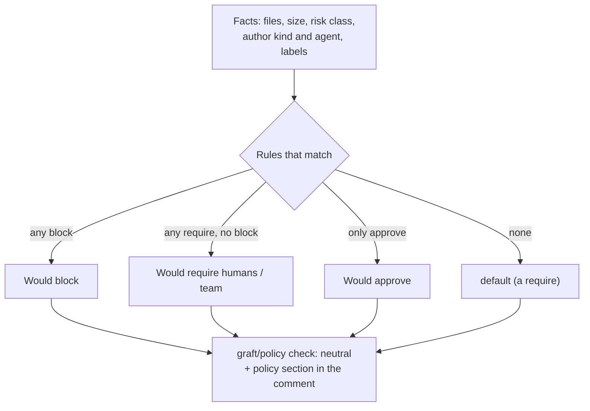

# Policy (graft.yaml)

[Docs index](../README.md) · [Full reference: graft-yaml.md](../graft-yaml.md) · [Example](../examples/graft.yaml)

`graft.yaml` describes how a repository wants its pull requests reviewed: which changes could be auto-approved, which need humans or a team, which are blocked. **In Phase 0 Graft only reports**: the `graft/policy` check always concludes `neutral`, so it approves and blocks nothing. Keep your branch protection as it is and do not make `graft/policy` a required check.



Since step 5 Graft evaluates the repository's `graft.yaml` for every open pull request and **reports** what it would do. Phase 0 enforces nothing: the `graft/policy` check run always concludes `neutral`, a would-approve is not an approval, and team membership is not checked (Phase 1). The reference is [docs/graft-yaml.md](../graft-yaml.md); a valid sample is [docs/examples/graft.yaml](../examples/graft.yaml) and the editor schema is [schema/graft.v1.schema.json](../../schema/graft.v1.schema.json).

```sh
pnpm graft policy check graft.yaml          # 0 valid, 1 invalid (one line per error), 2 usage or unreadable file
pnpm graft policy check graft.yaml --json
pnpm graft policy schema [--write | --check]
```

The rules combine like this: every matching rule applies, **block wins**, then any matching `require` wins over `approve`, and `default` applies when nothing matches. An unknown fact (a card that is not ready, provenance not yet computed, an incomplete file list) never loosens a verdict. A missing file, an invalid file or a PR that edits `graft.yaml` is never would-approved. The GitHub Action that lints the file in CI:

```yaml
# .github/workflows/graft-yaml.yml
name: graft.yaml
on:
  pull_request:
    paths: ["graft.yaml"]
permissions:
  contents: read
jobs:
  lint:
    runs-on: ubuntu-latest
    steps:
      - uses: actions/checkout@v4                 # pin to a commit SHA per your org policy
      - uses: actions/checkout@v4
        with:
          repository: mmornati/graft
          ref: <pinned commit SHA>
          path: .graft-tool
          token: ${{ secrets.GRAFT_TOOL_TOKEN }}  # only while the Graft repo is private
      - uses: pnpm/action-setup@v4
        with: { package_json_file: .graft-tool/package.json }
      - uses: actions/setup-node@v4
        with: { node-version: 24, cache: pnpm, cache-dependency-path: .graft-tool/pnpm-lock.yaml }
      - run: pnpm install --frozen-lockfile --dir .graft-tool
      - run: pnpm --dir .graft-tool graft policy check "$GITHUB_WORKSPACE/graft.yaml"
```

It uses `pull_request`, never `pull_request_target`, and the file is only parsed, never executed.

Placeholders in the workflow above: `<pinned commit SHA>` is the Graft commit you lint with (a full SHA, not a branch), and `GRAFT_TOOL_TOKEN` is a secret in **your** repository holding a fine-grained, read-only token for `mmornati/graft`, needed only while the Graft repository is private. The first `actions/checkout@v4` checks out your repository; pin both to commit SHAs as your organisation requires.

## Starter policies

[docs/pilots/](../pilots/) has three starter files, one per repository archetype: [graft.service.yaml](../pilots/graft.service.yaml), [graft.platform.yaml](../pilots/graft.platform.yaml) and [graft.library.yaml](../pilots/graft.library.yaml). CI checks all of them and the example with `pnpm graft policy check`.

## Related

- The policy contract (base branch only, signals, stored data): [architecture.md](../architecture.md#policy-contract-step-5).
- Glob matching, cost model and every review change: [decisions.md, step 5](../decisions.md#step-5-policy-engine).
- The step spec: [docs/phase-0/step-5-policy-engine.md](../phase-0/step-5-policy-engine.md).
