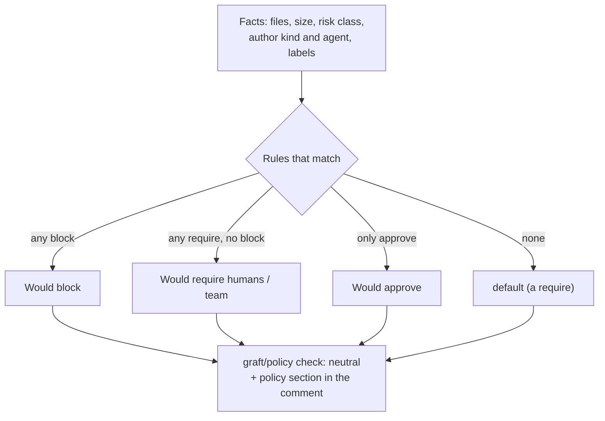

# Policy (graft.yaml)

[Docs index](../README.md) · [Full reference: graft-yaml.md](../graft-yaml.md) · [Example](../examples/graft.yaml)

`graft.yaml` describes how a repository wants its pull requests reviewed: which changes could be auto-approved, which need humans or a team, which are blocked. **By default Graft only reports**: the `graft/policy` check concludes `neutral`, so it approves and blocks nothing, and it says what it *would* conclude. An operator can turn on [enforce mode](#enforce-mode) for one repository at a time (Phase 1); until then keep your branch protection as it is and do not make `graft/policy` a required check.



Since step 5 Graft evaluates the repository's `graft.yaml` for every open pull request and **reports** what it would do. In report mode (the default) the `graft/policy` check run concludes `neutral` and a would-approve is not an approval. Since Phase 1 step 2 approvals are counted for real (write access, current head, verified team membership) in every mode, and enforce mode publishes the result. The reference is [docs/graft-yaml.md](../graft-yaml.md); a valid sample is [docs/examples/graft.yaml](../examples/graft.yaml) and the editor schema is [schema/graft.v1.schema.json](../../schema/graft.v1.schema.json).

```sh
pnpm graft policy check graft.yaml          # 0 valid, 1 invalid (one line per error), 2 usage or unreadable file
pnpm graft policy check graft.yaml --json
pnpm graft policy schema [--write | --check]
```

The rules combine like this: every matching rule applies, **block wins**, then any matching `require` wins over `approve`, and `default` applies when nothing matches. An unknown fact (a card that is not ready, provenance not yet computed, an incomplete file list) never loosens a verdict. A missing file, an invalid file or a PR that edits `graft.yaml` is never would-approved. The GitHub Action that lints the file in CI:

```yaml
# .github/workflows/graft-yaml.yml
name: graft.yaml
on:
  pull_request:
    paths: ["graft.yaml"]
permissions:
  contents: read
jobs:
  lint:
    runs-on: ubuntu-latest
    steps:
      - uses: actions/checkout@v4                 # pin to a commit SHA per your org policy
      - uses: actions/checkout@v4
        with:
          repository: mmornati/graft
          ref: <pinned commit SHA>
          path: .graft-tool
          token: ${{ secrets.GRAFT_TOOL_TOKEN }}  # only while the Graft repo is private
      - uses: pnpm/action-setup@v4
        with: { package_json_file: .graft-tool/package.json }
      - uses: actions/setup-node@v4
        with: { node-version: 24, cache: pnpm, cache-dependency-path: .graft-tool/pnpm-lock.yaml }
      - run: pnpm install --frozen-lockfile --dir .graft-tool
      - run: pnpm --dir .graft-tool graft policy check "$GITHUB_WORKSPACE/graft.yaml"
```

It uses `pull_request`, never `pull_request_target`, and the file is only parsed, never executed.

Placeholders in the workflow above: `<pinned commit SHA>` is the Graft commit you lint with (a full SHA, not a branch), and `GRAFT_TOOL_TOKEN` is a secret in **your** repository holding a fine-grained, read-only token for `mmornati/graft`, needed only while the Graft repository is private. The first `actions/checkout@v4` checks out your repository; pin both to commit SHAs as your organisation requires.

## Enforce mode

When a repository's effective `policy_mode` is `enforce` (the operator sets it, see [Modes](modes.md)), `graft/policy` concludes `success` or `failure`. In report mode the same conclusion is computed and stored, and the policy section shows it as **In enforce mode this check would be: …**, so a team can watch it before turning it on. A passing check is not a review approval: Graft never submits, requests or dismisses a review.

**What it concludes**, the first rule that applies:

1. No `graft.yaml` on the base branch, or an invalid one: `failure`. A repository that enforces must have a valid policy; the check says how to fix it.
2. A matching `block` rule: `failure`, whatever the approvals.
3. The intent card for the head is still being written: the check stays `in_progress` for at most `GRAFT_POLICY_CARD_WAIT_SECONDS` (default 600) after the head was first evaluated, then it is evaluated with the conservative rules that already apply to a pending card. A card that failed (`card_unavailable`) never waits.
4. More than 300 reviews (Graft reads at most 300): `failure`, because a review it did not read could be a change request.
5. A change request from someone with write access, still outstanding: `failure` until they approve or the review is dismissed. This replaces the "request changes blocks merging" behaviour of required reviews in branch protection.
6. `would_approve`: `success`.
7. `would_require`: `success` when every constraint is met, otherwise `failure`.

**Who counts.** An approval counts when it is the reviewer's latest review, it was submitted on the current head commit, and the reviewer has `write`, `maintain` or `admin` on the repository (a custom role counts by its base permission). The PR author and bots never count. A triage or read collaborator does not count. Approvals on an older commit are **stale**: shown, never counted, never dismissed (no new write). Like GitHub, Graft does not exclude the last pusher or commit co-authors.

**Constraints.** Each `require` is checked on its own, and one approver may satisfy several of them. A constraint without a team is met by enough counted approvers. A team constraint is met by counted approvers who are **active** members of one of its teams, checked with the GitHub API at evaluation time (`GET /orgs/{org}/teams/{team}` once per team, then one membership request per approver until the constraint is met; nothing is cached or stored). A team is **unverified**, and contributes nobody, when the App lacks `members: read`, the repository owner is a user account rather than an organization, the team does not exist, or the App cannot read it. The details list each constraint as `1 of 2 from @acme/security: alice` or with the reason it could not be verified.

**Bounds.** At most 20 approvers and 20 change requesters are permission-checked, 20 teams looked up and 100 memberships requested per evaluation. Owners, organization members and collaborators (the review's `author_association`) are checked first, then everyone else, each group in login order; the association only orders the checks and never replaces one. Past a bound the rest is unverified (`check_limit`) and never counts; a change requester past the bound counts as blocking.

**Re-evaluation** happens on every PR event that already triggered it (push, edit, labels, reviews, re-run, card and provenance publication, a base branch change to `graft.yaml`, mode changes), at the end of the card wait, and on `membership` and `team` events: those re-evaluate the installation's open PRs whose latest verdict has a team constraint, at most once per five-minute window, after the window closes (so 1 to 6 minutes after the event, and never before a later event of the same window). A collaborator permission change is picked up at the next trigger.

Before enforcing on a repository: accept `members: read` and the `membership` and `team` events (see [GitHub App](../github-app.md)), make `graft/policy` a required status check **with the Graft App as its source**, and do not enforce on a repository that uses a merge queue (`merge_group` is not handled).

## Starter policies

[docs/pilots/](../pilots/) has three starter files, one per repository archetype: [graft.service.yaml](../pilots/graft.service.yaml), [graft.platform.yaml](../pilots/graft.platform.yaml) and [graft.library.yaml](../pilots/graft.library.yaml). CI checks all of them and the example with `pnpm graft policy check`.

## Related

- The policy contract (base branch only, signals, stored data): [architecture.md](../architecture.md#policy-contract-step-5).
- Glob matching, cost model and every review change: [decisions.md, step 5](../decisions.md#step-5-policy-engine).
- The step spec: [docs/phase-0/step-5-policy-engine.md](../phase-0/step-5-policy-engine.md).
