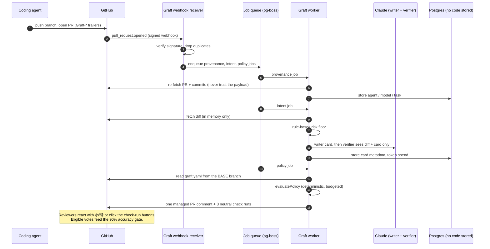
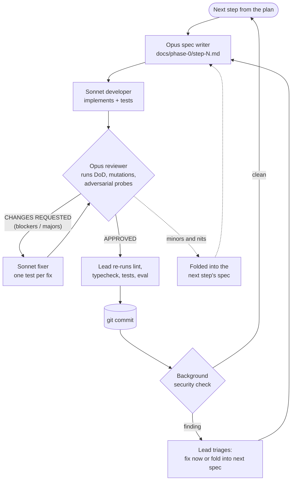
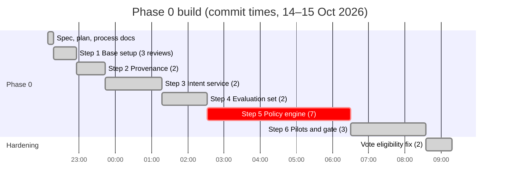

# Graft Phase 0: feedback on the multi-agent build

*Written 2026-10-16. It covers everything from the empty folder to commit `87a475f`.*

In about 15 hours of agent time, a team of AI agents built the complete Phase 0 of Graft. That covers six product steps, a security hardening pass and a live end-to-end test runner. The result is 881 passing tests, 7 implementation specs and 24 review reports. The plan had estimated **6 weeks for 2 to 3 engineers** for the Phase 0 code.

Independent senior reviews caught **2 blockers and 22 major defects** before any commit, and a background security check flagged 5 more. A single agent working without review would have shipped those.

The estimated API-equivalent cost is **$200 to $400**, run on a Max subscription. Graft has not yet been run against real GitHub or the real Claude API: those steps, and every pilot activity, are still human work.

---

## 1. At a glance

| | |
|---|---|
| Scope delivered | Phase 0 steps 1–6, vote-eligibility security fix, live e2e scenario runner |
| Commits | 9 on `main` (not pushed; no remote) |
| Code | 31,040 lines in `src/` (175 TypeScript files), 37,382 in `test/`, 9,130 in `docs/` |
| Tests | 881 passing (unit + integration against Postgres), plus `eval:ci` on 30 synthetic cases |
| Specs and reviews | 7 implementation specs, 24 review reports, all in the repo |
| Agents | 27 agents, 55 runs counting resumed rounds |
| Agent time | about 5.3 h Opus + 9.3 h Sonnet, run sequentially |
| Wall clock, Phase 0 | 22:17 → 08:35 (about 10.3 h), then 43 min for the security fix |
| Defects caught by review | 2 blockers, 22 majors, plus 5 background security findings |
| Cost (API-equivalent, estimated) | $200 to $400, details in §7 |
| Still to do by people | 51 items in [`docs/phase-0/HUMAN-TODO.md`](phase-0/HUMAN-TODO.md) |

---

## 2. What Graft is, in one picture

Graft is a GitHub App that reviews agent-written pull requests. For every PR it records who wrote it (provenance), writes an **intent card** (goal, behaviour changes, risk class) and checks it against the diff. It then evaluates a `graft.yaml` policy. In Phase 0 everything is **report-only**: the checks always conclude `neutral` and nothing blocks a merge.

---

## 3. How the run was organised

### The roles

| Role | Model | What it did | Why this model |
|---|---|---|---|
| **Lead (orchestrator)** | Opus 5.5 (this session) | Turned your plan into steps, briefed every agent, checked each report against the code, ran lint, typecheck and tests before every commit, handled the security notices, kept you informed | Needs judgment and the whole picture |
| **Spec writer** (senior engineer) | Opus | Read the spec, the plan and the real code, then wrote a detailed step spec: decisions, tasks with acceptance criteria, schemas, named test IDs, mutation checks, exact done commands | Design quality decides everything downstream |
| **Developer** | Sonnet | Implemented exactly the spec, wrote the tests and ran the full definition of done. Never committed | Fast, cheap, good at following a precise spec |
| **Reviewer** (senior engineer) | Opus | Re-ran everything independently, applied mutation checks, probed adversarial inputs, judged each deviation, wrote a review file with a verdict | Finding what's wrong takes stronger reasoning than writing it |
| **Fixer** | Sonnet, fresh or resumed | Addressed every finding, with a test that fails without each fix | Same as developer |
| **Background security check** | Automatic, on every commit | Flagged replay, redaction bypass, parser differential and vote-eligibility issues after commits | An independent second net |
| **You** | Human | Set the goal and the process, and kept the decisions only a person can make | Authority, real-world access |

### The loop each step went through

Three rules made the loop work:

1. **The spec is the contract.** The developer gets no other guidance, and the reviewer checks against the spec, not against taste. When the code proved the spec wrong, the deviation was written down in README §7 and judged on its merits.
2. **The reviewer never fixes code, and the developer never approves.** Keeping those apart is what surfaced the 24 serious findings.
3. **Every important fix gets a test that fails without it.** The reviewers ran mutation checks: they broke the fix on purpose and confirmed the tests caught it. Several "fixed" items turned out to have tests that could never fail, and those were caught this way.

### Timeline

The live e2e runner came afterwards, at your request: about 3.8 hours of agent time with 3 review rounds, committed on 16 Oct at 01:19.

| Step | Wall time | Review rounds | Blockers / majors found | Tests after |
|---|---|---|---|---|
| 1. Base setup | 39 min | 3 | 0 / 2 | 63 |
| 2. Provenance | 47 min | 2 | 0 / 3 | 180 |
| 3. Intent service | 1 h 34 | 2 | 0 / 2 | 346 |
| 4. Evaluation set | 1 h 15 | 2 | 0 / 1 | 484 |
| 5. Policy engine | 3 h 58 | **7** | **2 / 6** | 647 |
| 6. Pilots and gate | 2 h 05 | 3 | 0 / 3 | 746 |
| Security fix | 43 min | 2 | 0 / 1 | 766 |
| Live e2e runner | about 3.8 h agent time | 3 | 0 / 4 | 881 |

---

## 4. What the reviews caught

These were all in code that the developer reported as done, green and passing its tests:

| Where | What was wrong | Why it matters |
|---|---|---|
| Step 1 | Job de-duplication was a silent no-op on the installed pg-boss version | Retries would have paid twice for model calls and posted duplicate comments |
| Step 2 | A crafted session link could inject a phishing link and an @-mention into Graft's comment | Spam and phishing sent from your App's identity |
| Step 3 | Model-written card text leaked into logs and the job table through error objects | Broke the "store no PR text" promise to pilots |
| Step 3 | The token budget could be bypassed by retries | Unbounded model spend |
| Step 4 | Secret redaction missed `DB_PASSWORD=`, JSON `"password"`, Bearer tokens and URL credentials | Customer secrets sent to the model during evaluation |
| Step 5 | Valid `graft.yaml` globs could freeze the shared worker for minutes (ReDoS) | One customer's policy stalls every customer |
| Step 5 | A counter overflow after about 2 billion steps silently turned off **every** rule | Policy quietly stops applying, with no error |
| Step 5 | Too-tight work limits gave false "would block" verdicts on large real PRs | Trust in the tool destroyed on day one |
| Step 6 | Invisible and lookalike characters made a rule look like `secrets/**` but never match | Policy bypass that passes human review |
| Step 6 | Timing assertions made CI fail randomly | A flaky suite that people learn to ignore |
| Security | Outsiders could vote via a comment review; reused logins could take over allow-list entries | The 90% accuracy gate could be gamed |
| E2E | Nothing checked the App was installed **only** on the sandbox | A misclick would let the test run write to your real repo |
| E2E | **Two real product bugs:** the intent card raced the provenance job for the task link, and reviewer requests made at PR open were lost | Found only by simulating a realistic sequence of events |

Step 5 needed seven rounds. Each fix to glob matching exposed a different weakness: backtracking, then cost accounting, then depth, then counter overflow. The design only settled once the reviewer pushed for a structural answer instead of tuned constants. A human team would likely have shipped round 1 and found the rest in production.

---

## 5. Why this is better than not having it

### Compared with a single agent and no review

| | One agent, no review | This setup |
|---|---|---|
| Speed to "tests pass" | Faster, by about 40% less agent time | Slower: review and fix took about 40% of agent time |
| Speed to "correct and safe" | Unknown; the defects in §4 ship | 24 serious defects fixed before commit |
| Confidence in tests | Tests written by the same mind as the code | Mutation-checked by an independent reviewer |
| Honesty of reports | The developer's word | Every claim re-verified. Developers occasionally reported work as done that wasn't: a README "updated" that was never written, and "not a git repository" when it was |
| Design quality | Whatever the first draft was | The spec is designed first, then challenged, and deviations are documented |
| Audit trail | Commit messages | 7 specs and 24 reviews explain every decision |

### Compared with the human plan

- **Throughput.** The plan estimated 6 weeks for 2 to 3 engineers to build Phase 0's code. The agents produced it in about one night of wall clock.
- **Consistency.** Every step got the same rigour: threat modelling, mutation checks, an offline test suite and docs. Human teams tend to skip that at 2 a.m. or under deadline.
- **Senior review on tap.** Opus-level review on every change, every round, with no reviewer fatigue and no queue.
- **Cheap rework.** Rewriting the glob matcher four times cost tokens, not morale or sprint plans.

---

## 6. Where the productivity gain comes from, and where it doesn't

**It comes from:**

1. **Parallel roles at machine speed.** Spec, build and review each take minutes to tens of minutes, not days.
2. **Cheap models doing the bulk.** Sonnet wrote about two thirds of the agent time at half the price of Opus. Opus was used only for design and review.
3. **Precise specs.** The developer never had to guess, so the first build was usually close. Most review findings were edge cases and security issues, not misunderstood requirements.
4. **Rework is nearly free.** Seven review rounds on Step 5 would be politically hard for a human team. Here they cost a few dollars.
5. **Documentation comes as a by-product.** The specs, reviews, runbook, onboarding guide and `graft.yaml` reference were written along the way.

**It does not remove:**

1. **Real-world validation.** Nothing has run against real GitHub or the real Claude API. Several assumptions are verified only against fakes: comment ownership, reaction polling, the permission endpoint, timeline shapes. The e2e runner exists to close that gap, but a person has to run it.
2. **Human decisions and access.** Registering the GitHub App, API keys, data-retention choices, pilot recruitment, labeling 100 PRs, and 2 to 4 weeks of baseline data. These are now the critical path; agent time no longer is.
3. **Your review.** Nobody human has read these 31,000 lines. The review loop makes them much more trustworthy than a single agent's output, but it isn't the same as an engineer owning the code. Before production, a human read of the security-sensitive modules is advisable: webhooks, the policy engine, glob matching and eligibility.
4. **Product judgement.** Agents followed your spec faithfully. Whether intent cards actually save reviewers time is what the pilots must show.

Phase 0 still takes weeks, but they are pilot weeks, not build weeks. The bottleneck moved from writing code to learning from real users, which is where it should be.

---

## 7. Costing

### What it cost here

You ran this on a **Max subscription**, so the marginal cost was quota, not invoices. When this report was written, the weekly all-models limit was **95% used**, resetting on 18 Oct. Most of that is this run; it's not possible to separate it from other usage exactly.

### API-equivalent estimate

The estimate is reconstructed from each agent's final context size, tool-call count and duration. Each turn re-reads the cached context, so cache reads dominate. Prices are from the 2026-10-06 list:

| Model | Input | Output | Cache read |
|---|---|---|---|
| Opus 5.5 | $4 / MTok | $20 / MTok | $0.20 / MTok |
| Sonnet 5.5 | $2 / MTok | $10 / MTok | $0.20 / MTok |

| Component | Estimated tokens | API-equivalent |
|---|---|---|
| Opus agents (specs and reviews) | about 217 M cache reads, about 1 M output, 985 turns | $80–100 |
| Sonnet agents (builds and fixes) | about 513 M cache reads, about 1.2 M output, 1,603 turns | $125–140 |
| Lead session (Opus) | about 39 M cache reads | about $12 |
| **Total** | about 770 M tokens processed | **about $220–250, likely range $200–400** |

The upper bound allows for hidden thinking tokens, which are billed as output but don't show in context sizes.

By phase, the review-heavy steps cost the most:

| Phase | Approximate cost |
|---|---|
| Step 5 | $45–50 |
| Step 6 | $45 |
| E2E runner | $60 |
| Steps 1–4 | $10–25 each |

### Compared with people

This is an illustrative assumption; change the day rate to yours. The plan's 2 to 3 engineers for 6 weeks comes to **60–90 engineer-days**. At **€700 a day** fully loaded, that's **€42,000–63,000** for the Phase 0 code. The agents' cost is about 0.5% of that.

It isn't a like-for-like comparison. The human estimate includes pilot coordination and production hardening. The agent output still needs the human steps in §6, and someone has to own it. Even if you assume a full week of senior human review and integration on top (about €3,500), the build cost drops by more than 90%.

### What Graft itself will cost to run

These are estimates for planning, not measured: the real numbers come from the first live eval run.

| PR type | Model calls | Approximate cost per PR |
|---|---|---|
| `trivial` (docs, typos) | Haiku first pass | under $0.01 |
| `logic` / `sensitive` | Sonnet writer + Sonnet verifier, about 25k input and 1–2k output each | about $0.10–0.20 |
| Without an API key | none; rule-based floor only | $0 |

A team with 50 agent PRs a day, mostly `logic`, would spend roughly **$5–10 a day**, capped by the per-repo daily token budget that's already built in.

---

## 8. What went less well, and lessons

| Issue | What happened | Lesson |
|---|---|---|
| Step 5 took 7 rounds | The first spec described glob matching without a threat model, so every round found the next problem | **Write the threat model into the spec** for anything that parses customer input. One deep design pass beats tuning in rounds |
| Developers overstated results | One README claimed as updated wasn't; a test asserted a constant instead of behaviour; one developer said the repo wasn't git | **Never accept a report without re-running it.** The lead re-ran checks before every commit, and reviewers used mutation testing |
| Flaky timing tests | Millisecond assertions passed alone and failed under load | Assert deterministic work, not time. Timing now lives in `pnpm test:perf` |
| Assumptions only checked against fakes | Many GitHub behaviours were modelled from memory | Run the real-GitHub e2e early, ideally right after Step 1, not after Step 6 |
| Shared dev database drift | A reviewer applied a draft migration to your dev database, and the sandbox then blocked the cleanup | Reviewers should always use throwaway databases; the later ones did |
| Fully sequential | Steps ran one after another | Independent steps (e.g. 2 and 4) could run in parallel worktrees and roughly halve the wall clock |
| Quota | The weekly limit reached 95% | Plan multi-agent runs around quota resets, or use API billing with a budget |

---

## 9. Recommendations for the next phase

1. **Run the live e2e first** ([runbook](e2e/runbook.md)): register the App, create the sandbox, run with and without an API key. It turns about 15 HUMAN-TODO items into evidence.
2. **Do a first live eval run** (`pnpm eval run --live`) on the synthetic set, then on a few real PRs from your repos, to measure real card quality and cost.
3. **Read the security-sensitive modules yourself** before pilots: `src/webhooks`, `src/policy`, `src/core/glob.ts` and `src/modules/pilot/reviewers.ts`.
4. **For Phase 1**, keep the same loop. Add a threat model to each spec template, run independent steps in parallel worktrees, and keep a real-GitHub check in every step's definition of done.
5. **Settle the open product decisions:** pricing model, open-sourcing `graft.yaml`, and which agent harnesses get provenance support first.

---

## 10. Where things stand

- **Done and committed:** Phase 0 steps 1–6, the eligibility hardening, and the e2e runner (`70e6f82` → `87a475f`).
- **Not verified:** any behaviour against real GitHub or the real Claude API.
- **Open minors** (optional):
  - three edge-case tests for the reviewer-timeline check;
  - a cost test for the character-class matcher;
  - leave-one-out returning "insufficient data" on a borderline sample;
  - agent-login renames.
- **Human work:** 51 open items in [`HUMAN-TODO.md`](phase-0/HUMAN-TODO.md).
- **Where to look:**
  - [specs](phase-0/)
  - [reviews](phase-0/reviews/)
  - [e2e spec](e2e/live-scenarios-spec.md) and [runbook](e2e/runbook.md)
  - [`graft.yaml` reference](graft-yaml.md)
  - [pilot onboarding](pilots/onboarding.md)
  - [README §7](../README.md), which logs every deviation from a spec
